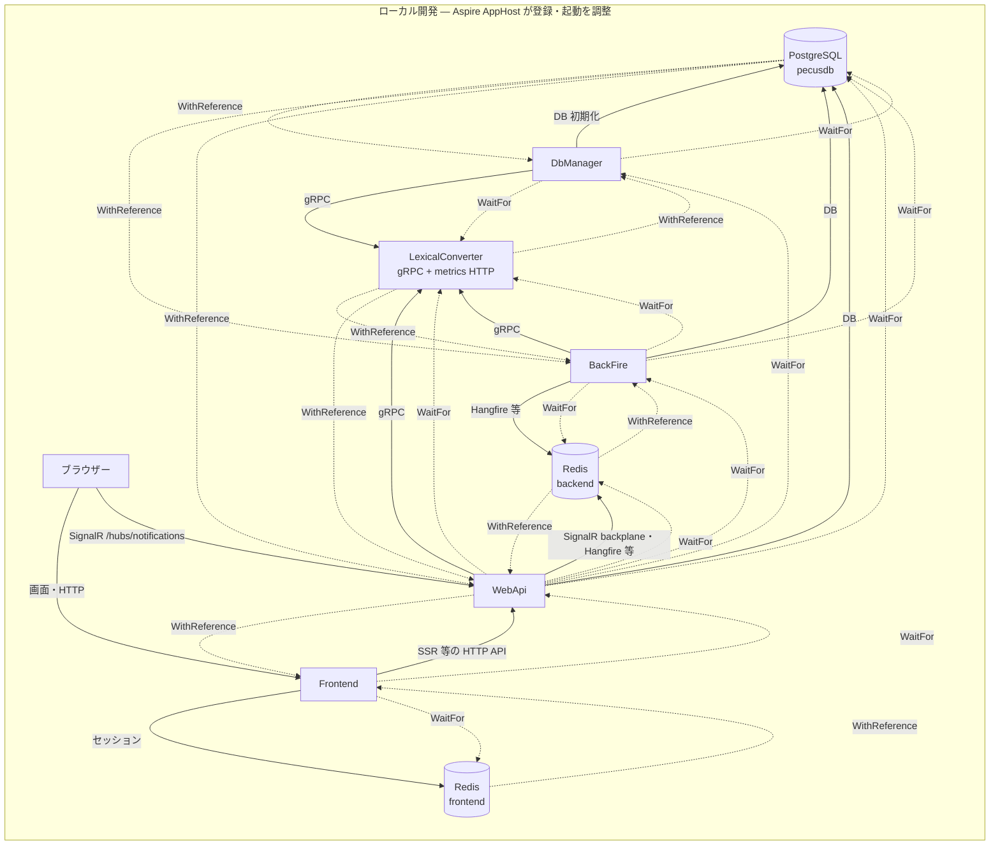
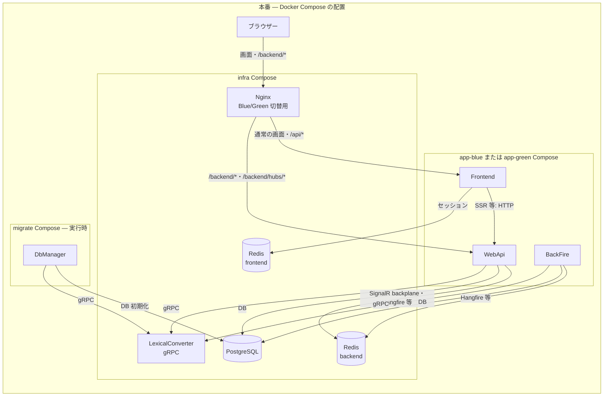

# 実行単位とサービス境界

## 概要

Coati は、Web API・Next.js フロントエンド・バックグラウンド処理・DB 初期化処理・Lexical 変換サービスを別々の実行単位として持つ。ローカルでは `pecus.AppHost` が Aspire のリソースグラフを定義し、本番では Compose ファイル群がコンテナの配置単位を定義する。AppHost の登録は本番起動の定義ではない。[AppHost](../../pecus.AppHost/AppHost.cs) [本番 infra Compose](../../deploy/docker-compose.infra.yml) [本番 blue Compose](../../deploy/docker-compose.app-blue.yml)

## ソリューションを構成するプロセス

| プロジェクト／パッケージ | 所有する実行単位・役割 |
|---|---|
| `pecus.WebApi` | ASP.NET Core の HTTP API を提供し、`/hubs/notifications` に SignalR Hub を公開する。PostgreSQL、バックエンド Redis、Lexical Converter のクライアントも登録する。[Program.cs](../../pecus.WebApi/Program.cs) |
| `pecus.BackFire` | Hangfire Server を起動し、スケジュールされたバックグラウンド処理を実行する。WebApi と同じ PostgreSQL／バックエンド Redis を参照し、通知連携や Lexical Converter クライアントも登録する。[Program.cs](../../pecus.BackFire/Program.cs) |
| `pecus.DbManager` | `DbInitializer` をホストサービスとして起動し、DB 初期化・マイグレーション等を担う実行単位。DB と Lexical Converter を参照する。[Program.cs](../../pecus.DbManager/Program.cs) |
| `pecus.Frontend` | Next.js のフロントエンドサーバー。SSR 等から WebApi の HTTP API を呼び、フロントエンド専用 Redis をセッションストアとして利用する。[package.json](../../pecus.Frontend/package.json) [環境 URL／Redis の解決](../../pecus.Frontend/src/libs/env.ts) [サーバーセッション](../../pecus.Frontend/src/libs/serverSession.ts) |
| `pecus.LexicalConverter` | Node.js/NestJS の gRPC マイクロサービス。Lexical JSON と HTML／Markdown／プレーンテキスト等の相互変換を提供する。メトリクス等の HTTP サーバーも別ポートで listen する。[main.ts](../../pecus.LexicalConverter/src/main.ts) [gRPC 契約](../../pecus.Protos/lexical/lexical.proto) |
| `pecus.Libs` | DB、業務サービス、gRPC クライアント等を含む共有 .NET ライブラリであり、単独の実行プロセスではない。複数の実行プロジェクトから参照される。[プロジェクト定義](../../pecus.Libs/pecus.Libs.csproj) |
| `pecus.ServiceDefaults` | Serilog、OpenTelemetry、ヘルスチェック、サービスディスカバリー、HTTP resilience などの共通ホスト設定を提供する共有ライブラリであり、独立したサービスではない。[Extensions.cs](../../pecus.ServiceDefaults/Extensions.cs) |
| `pecus.Protos` | Lexical gRPC の `.proto` 契約を保持する場所であり、実行プロセスではない。`pecus.Libs` のプロジェクト定義はこの契約から gRPC クライアントコードを生成する。[lexical.proto](../../pecus.Protos/lexical/lexical.proto) [Libs project](../../pecus.Libs/pecus.Libs.csproj) |
| `packages/coati-editor` | Lexical ベースのエディター／ビューアー等をエクスポートするフロントエンド向けパッケージ。プロセスではなく、Frontend と Converter が共有するコード資産である。[package.json](../../packages/coati-editor/package.json) [README](../../packages/coati-editor/README.md) [Frontend dependency](../../pecus.Frontend/package.json) |

## ローカル実行時の依存グラフ

AppHost は PostgreSQL と `pecusdb`、バックエンド用 `redis`、フロントエンド用 `redisFrontend`、Lexical Converter を登録し、その上に DbManager、BackFire、WebApi、Frontend を登録する。[AppHost.cs](../../pecus.AppHost/AppHost.cs) PostgreSQL／Redis のポートは AppHost の設定で指定される場合を除き Aspire が割り当てる。PostgreSQL には `pecusdb` データベースが作成される。[AppHost.cs](../../pecus.AppHost/AppHost.cs)

図中の**実線**はアプリケーションの機能通信、ラベル付きの**点線矢印**は AppHost のリソース関係を示す。`WithReference` は接続情報・サービスエンドポイントの注入、`WaitFor` は依存リソースのレディネス待ちであり、ラベルで区別する。いずれも、それ自体は機能呼び出しではない。たとえば Frontend は WebApi を参照・待機するが、実際の HTTP 要求は Frontend のコードが行う。[AppHost.cs](../../pecus.AppHost/AppHost.cs) [Frontend API URL 解決](../../pecus.Frontend/src/libs/env.ts)

この依存待ちは AppHost 上の宣言であり、アプリケーション間の機能的な呼び出しとは別である。Converter では gRPC の listen 開始後に `/health` が応答するようにして、AppHost のヘルスチェックをレディネス判定に使う。[AppHost.cs](../../pecus.AppHost/AppHost.cs) [LexicalConverter main.ts](../../pecus.LexicalConverter/src/main.ts) API の `WaitFor(dbmanager)` は、WebApi の起動前に DbManager の初期化処理が完了するように置かれている。[AppHost.cs](../../pecus.AppHost/AppHost.cs) [DbManager Program.cs](../../pecus.DbManager/Program.cs) [DbInitializer.cs](../../pecus.DbManager/DbInitializer.cs)

## 本番 Compose の配置単位

本番は AppHost ではなく、Compose ファイル群とデプロイ運用が起動単位を定義する。`docker-compose.infra.yml` は PostgreSQL、バックエンド Redis、フロントエンド Redis、Lexical Converter、Blue/Green 切替用 Nginx を定義する。[infra Compose](../../deploy/docker-compose.infra.yml) アプリケーションは blue／green の Compose に分かれ、それぞれ WebApi、Frontend、BackFire のスロットを持つ。どちらのスロットを有効にするか、起動順をどう制御するかは AppHost の `WaitFor` ではなく、Compose コメントにある通り運用スクリプト側に委ねられる。[blue Compose](../../deploy/docker-compose.app-blue.yml) [green Compose](../../deploy/docker-compose.app-green.yml)

`docker-compose.migrate.yml` は DbManager を単独の実行単位として定義し、PostgreSQL と Lexical Converter のヘルスチェック完了を `depends_on` で待つ。監視基盤は別の `docker-compose.monitoring.yml` に分離される。これらの Compose は共通の外部ネットワーク `pecus-network` を使い、infra Compose が同名のネットワークを作成する。[migration Compose](../../deploy/docker-compose.migrate.yml) [monitoring Compose](../../deploy/docker-compose.monitoring.yml) [infra Compose](../../deploy/docker-compose.infra.yml)

Compose の `pecus-network` はサービス間の到達性を与える配置境界で、Aspire の `WithReference`／`WaitFor` と同じ宣言ではない。特に app slot 側は別 Compose との `depends_on` を持たず、infra 側にプロセス依存の宣言を置いていない。Nginx の設定は `/backend/` と `/backend/hubs/` を WebApi に、通常の画面・`/api/` を Frontend に振り分ける。本番図のこの経路は Nginx 設定に基づき、Blue/Green の実際の切替値は別の active-slot 設定で与えられる。[blue Compose](../../deploy/docker-compose.app-blue.yml) [infra Compose](../../deploy/docker-compose.infra.yml) [Nginx routing](../../deploy/nginx/conf.d/10-coati.conf) [active slot](../../deploy/nginx/conf.d/00-active-slot.conf)

## 通信・データ境界

- **HTTP:** ブラウザー向けの画面は Frontend が提供し、Frontend サーバーは設定された WebApi URL に HTTP API 要求を送る。本番 Compose は Frontend に WebApi の内部 URL を設定する。[Frontend env.ts](../../pecus.Frontend/src/libs/env.ts) [blue Compose](../../deploy/docker-compose.app-blue.yml)
- **SignalR:** WebApi が `/hubs/notifications` を Hub として公開する。ブラウザー側の SignalR 利用は Frontend の SignalR Provider／Hook を通り、WebApi の HTTP API 呼び出しとは別の接続である。[WebApi Program.cs](../../pecus.WebApi/Program.cs) [SignalR Provider](../../pecus.Frontend/src/providers/SignalRProvider.tsx) [SignalR Hook](../../pecus.Frontend/src/hooks/useSignalR.ts) WebApi は Redis backplane を登録し、BackFire は通知を Redis Pub/Sub で発行し、WebApi の BackgroundService が受信して SignalR グループへ転送する。[WebApi Program.cs](../../pecus.WebApi/Program.cs) [Publisher](../../pecus.Libs/Notifications/SignalRNotificationPublisher.cs) [Subscriber](../../pecus.WebApi/Services/SignalRNotificationSubscriber.cs)
- **gRPC:** WebApi、BackFire、DbManager は `ILexicalConverterService` を登録して Node.js の Lexical Converter を利用する。DbManager のシード経路では Markdown から Lexical JSON／プレーンテキストへの変換を行う。[WebApi Program.cs](../../pecus.WebApi/Program.cs) [BackFire Program.cs](../../pecus.BackFire/Program.cs) [DbManager Program.cs](../../pecus.DbManager/Program.cs) [シード時の変換](../../pecus.Libs/DB/Seed/Atoms/CommonAtoms.cs) `.proto` は gRPC のメッセージ／RPC 契約であり、HTTP API や SignalR のプロトコルではない。[契約](../../pecus.Protos/lexical/lexical.proto) Converter は gRPC 用 listen とメトリクス用 HTTP listen を分ける。[main.ts](../../pecus.LexicalConverter/src/main.ts)
- **PostgreSQL:** `pecusdb` は WebApi／BackFire の業務データと DbManager の初期化対象となる共有データストアである。ローカル AppHost は `pecusdb` を PostgreSQL リソースに作成し、本番 infra Compose は PostgreSQL コンテナを配置する。[AppHost.cs](../../pecus.AppHost/AppHost.cs) [WebApi Program.cs](../../pecus.WebApi/Program.cs) [BackFire Program.cs](../../pecus.BackFire/Program.cs) [DbManager Program.cs](../../pecus.DbManager/Program.cs) [infra Compose](../../deploy/docker-compose.infra.yml)
- **Redis:** バックエンド `redis` は WebApi と BackFire が共有し、WebApi の SignalR backplane や両プロセスの Hangfire 等に使う。一方 `redisFrontend`／`redis-frontend` は Frontend 専用で、Frontend のサーバーセッションを保持する。Compose でも別サービス・別データボリュームである。[WebApi Program.cs](../../pecus.WebApi/Program.cs) [BackFire Program.cs](../../pecus.BackFire/Program.cs) [Frontend Redis client](../../pecus.Frontend/src/libs/redis.ts) [Frontend serverSession.ts](../../pecus.Frontend/src/libs/serverSession.ts) [infra Compose](../../deploy/docker-compose.infra.yml)

## 開発と本番のコンテキスト図

上の図の実線は機能呼び出し、ラベル付き点線は起動依存または接続情報の注入です。本番側は別 Compose ファイルに分割された配置を示し、Aspire AppHost による起動グラフを本番の起動主体として表していません。[AppHost.cs](../../pecus.AppHost/AppHost.cs) [本番 Compose 群](../../deploy/docker-compose.infra.yml)

## 関連ページ

- [SSR・セッション・フロントエンド要求経路](./01-frontend-request-session.md)
- [Web API・認証・公開契約](./02-webapi-boundary-security.md)
- [ユーザーの無効化・履歴とワークスペース業務](./03-user-lifecycle-workspace-domain.md)
- [DB 初期化・検索・整合性・ファイル永続化](./04-data-lifecycle-search-concurrency.md)
- [SignalR・プレゼンス・チャット通知](./05-realtime-chat-notifications.md)
- [Hangfire・AI クライアント・Bot](./06-background-ai-bots.md)
- [アジェンダ・Focus・実績](./07-agenda-focus-achievements.md)
- [共有 Lexical エディターと変換 gRPC](./08-editor-lexical-pipeline.md)
- [ローカル開発・設定・API／型生成](./09-local-development-code-generation.md)
- [本番ビルド・デプロイ・運用](./10-deployment-operations.md)
- [エージェント・ヘルプ・成果物作成フロー](./11-agent-content-workflows.md)

本ページは、2026-10-12 時点のコードと配置定義を確認した現状説明である。最終確認日: **2026-10-12**。
