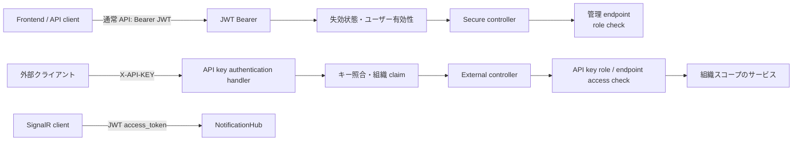

# Web API・認証・公開契約

本ページは、Web API の入口、認証方式、例外変換、OpenAPI 契約を現行コードから確認して説明します。外部 API の将来の安定性や、実行環境固有の認証設定は扱いません。

**最終確認日:** 2026-10-12

## HTTP パイプラインと層構造

[`Program.cs`](../../pecus.WebApi/Program.cs) は ASP.NET Core MVC、JWT Bearer、API key 認証、OpenAPI、SignalR、各サービスを登録します。開発環境では OpenAPI と Swagger UI を有効にします。HTTP logging と HTTPS redirection を構成した後、認証・認可ミドルウェアを通して controller と Hub を公開します。OpenAPI の external 文書は専用の `/api/external/openapi.json` route で提供されます。

通常の API は Controller が HTTP 契約を受け持ち、`pecus.WebApi/Services` のサービスが業務処理を担い、DB や共有処理は `pecus.Libs` にある `ApplicationDbContext` 等を介して利用します。例外は各 controller に散らさず、グローバルの [`GlobalExceptionFilter`](../../pecus.WebApi/Filters/GlobalExceptionFilter.cs) で HTTP 応答へ変換します。モデル検証には [`ValidationFilter`](../../pecus.WebApi/Filters/ValidationFilter.cs) も登録されています。

認証方式は controller の境界で異なります。一般の保護 API は JWT を、外部 API controller は API key scheme を使います。管理 API は JWT に加えて管理ロールを要求します。[`BaseSecureController`](../../pecus.WebApi/Controllers/BaseSecureController.cs) [`BaseAdminController`](../../pecus.WebApi/Controllers/Admin/BaseAdminController.cs) [`BaseExternalApiController`](../../pecus.WebApi/Controllers/External/BaseExternalApiController.cs)

## JWT 認証と権限確認

JWT Bearer 設定は署名、発行者、受信者、期限を検証します。トークン検証後の処理では、ユーザー ID や発行時刻等から失効状態を確認し、DB 上のユーザーが有効かどうかも確認します。無効化済みユーザーのトークンは認証成功として扱われません。[WebApi `Program.cs`](../../pecus.WebApi/Program.cs) [`JwtBearerUtil`](../../pecus.WebApi/Libs/JwtBearerUtil.cs)

通常の secure controller は認証主体から user／organization 情報を取得します。管理 controller は `Admin` または `BackOffice` ロールを要求します。認証と業務権限チェックの結果は同じではなく、controller の基底クラスと各 endpoint の属性によりアクセス可否が決まります。[`BaseSecureController`](../../pecus.WebApi/Controllers/BaseSecureController.cs) [`BaseAdminController`](../../pecus.WebApi/Controllers/Admin/BaseAdminController.cs)

SignalR Hub 接続は JWT 認証を利用し、WebSocket の接続時にクエリの `access_token` を受け取れるよう、Hub パスについて token extraction を構成しています。トークン値や signing 設定はここには記載しません。[WebApi `Program.cs`](../../pecus.WebApi/Program.cs) Hub とブラウザー側の接続経路は[SignalR・プレゼンス・チャット通知](./05-realtime-chat-notifications.md)を参照してください。

## 外部 API key 認証

外部 API の認証 handler は `X-API-KEY` を受け取り、[`ExternalApiKeyService`](../../pecus.Libs/DB/Services/ExternalApiKeyService.cs) による検証を行います。DB にはキーのハッシュ等を保存し、受信したキーを照合します。成功時の認証主体には API key と組織を識別する claim が設定されます。[`ApiKeyAuthenticationHandler`](../../pecus.WebApi/Authentication/ApiKeyAuthenticationHandler.cs)

認証 handler が成立させるのは API key の本人性・組織境界であり、キーの操作ロールを claim に含めるわけではありません。[`BaseExternalApiController`](../../pecus.WebApi/Controllers/External/BaseExternalApiController.cs) は key 情報を参照し、[`ExternalApiAccessAttribute`](../../pecus.WebApi/Authentication/ExternalApiAccessAttribute.cs) に定義されたアクセス要件を endpoint ごとに確認します。外部 API controller はキーの組織にスコープされたデータを扱います。[`ExternalController`](../../pecus.WebApi/Controllers/External/ExternalController.cs)

キー発行時に生成された平文キーは作成結果として返され、保存データはそのまま再表示するためのものではありません。具体的なキーや認証設定値は記載しません。外部 controller にある endpoint と契約は現行実装の説明であり、将来にわたる API 互換性の保証とは区別します。

## 図: 認証方式と API 境界

JWT と API key は異なる scheme と authorization path を通ります。図は実装上の境界を表すもので、外部 API が JWT API の一部として認証されるという意味ではありません。[JWT/API key handler](../../pecus.WebApi/Program.cs) [`ApiKeyAuthenticationHandler`](../../pecus.WebApi/Authentication/ApiKeyAuthenticationHandler.cs) [`ExternalApiAccessAttribute`](../../pecus.WebApi/Authentication/ExternalApiAccessAttribute.cs)

## 例外・検証・409 Conflict

[`GlobalExceptionFilter`](../../pecus.WebApi/Filters/GlobalExceptionFilter.cs) は例外型に応じて HTTP status と応答 body を組み立てます。`ConcurrencyException<T>` は 409 Conflict として扱い、競合時の current model を応答へ含めます。`UnauthorizedAccessException`、not found、bad request 等にも対応する分岐があり、分類されない例外はサーバーエラーになります。個別の status mapping は filter の実装を参照してください。

409 の実 body は filter が組み立てる匿名オブジェクトで、`statusCode`、`message`、`current`、`details` の形です。OpenAPI 宣言用の [`ConcurrencyErrorResponse<T>`](../../pecus.WebApi/Models/Responses/Common/ConcurrencyErrorResponse.cs) と、実際の応答生成は区別します。フロントエンドは OpenAPI schema から競合型を生成するため、schema と実応答の双方を確認する必要があります。[`generate-conflict-types.js`](../../pecus.Frontend/scripts/generate-conflict-types.js) 楽観的競合の DB 側実装は[DB 初期化・検索・整合性・ファイル永続化](./04-data-lifecycle-search-concurrency.md)を参照してください。

## OpenAPI 文書とクライアント生成

WebApi は複数の OpenAPI document を定義し、external endpoint のグループを別文書に分けます。API key 用 security scheme と JWT 用 security scheme は OpenAPI transformer で endpoint の境界に対応付けられます。[`Program.cs`](../../pecus.WebApi/Program.cs) [`ApiSecuritySchemeTransformer`](../../pecus.WebApi/OpenApi/ApiSecuritySchemeTransformer.cs) 外部 API の仕様が将来にわたり固定されるかは、この実装からは断定できません。

Frontend の OpenAPI schema download と Hey API Axios client 生成は、アプリケーションの runtime 呼び出しではなく開発時の生成フローです。生成ディレクトリは自動生成物として扱い、手書きの認証 wrapper 等と分離します。[Hey API 指示](../../.github/instructions/hey-api.instructions.md) [ローカル開発・設定・API／型生成](./09-local-development-code-generation.md)

## 主なコード実体

| 責務 | 実装 |
|---|---|
| HTTP pipeline と OpenAPI 登録 | [`Program.cs`](../../pecus.WebApi/Program.cs) |
| JWT/API key 認証 | [`Program.cs`](../../pecus.WebApi/Program.cs)、[`ApiKeyAuthenticationHandler`](../../pecus.WebApi/Authentication/ApiKeyAuthenticationHandler.cs) |
| 外部 API の属性・組織境界 | [`ExternalApiAccessAttribute`](../../pecus.WebApi/Authentication/ExternalApiAccessAttribute.cs)、[`ExternalController`](../../pecus.WebApi/Controllers/External/ExternalController.cs)、[`ExternalApiKeyService`](../../pecus.Libs/DB/Services/ExternalApiKeyService.cs) |
| 例外・競合応答 | [`GlobalExceptionFilter`](../../pecus.WebApi/Filters/GlobalExceptionFilter.cs)、[`ConcurrencyException`](../../pecus.WebApi/Exceptions/ConcurrencyException.cs) |
| 競合型生成と Hey API | [Frontend conflict type generator](../../pecus.Frontend/scripts/generate-conflict-types.js)、[Hey API instructions](../../.github/instructions/hey-api.instructions.md) |

## 関連ページ

- [実行単位とサービス境界](./00-system-overview.md)
- [SSR・セッション・フロントエンド要求経路](./01-frontend-request-session.md)
- [ユーザー・組織・ワークスペース・アイテム・タスク](./03-user-lifecycle-workspace-domain.md)
- [DB 初期化・検索・整合性・ファイル永続化](./04-data-lifecycle-search-concurrency.md)
- [共有 Lexical エディターと変換 gRPC](./08-editor-lexical-pipeline.md)
- [ローカル開発・設定・API／型生成](./09-local-development-code-generation.md)
