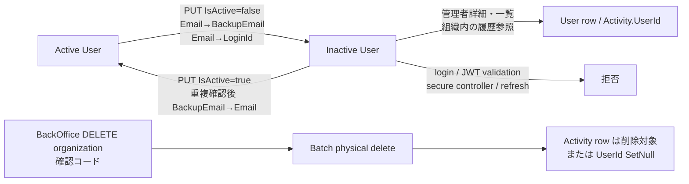
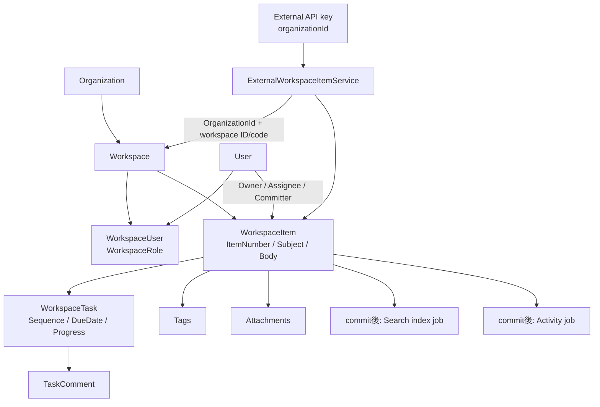

# ユーザーの無効化・履歴とワークスペース業務

最終確認日: **2026-10-12**

## 概要

Coati の共同作業データは、`Organization` の下に `Workspace` があり、ワークスペースに
`WorkspaceUser`（ユーザーとの多対多のメンバーシップ）が参加し、その中に
`WorkspaceItem` と `WorkspaceTask` が属する構造になっている。ユーザーの利用停止は、
通常は行を消さずにログインと通常利用を止める。一方、組織削除は BackOffice 専用の
物理削除であり、影響範囲も履歴の残り方も異なる。

## User と組織メンバーシップ

[`User`](../../pecus.Libs/DB/Models/User.cs) は `OrganizationId`、`Roles`、
`UserSkills`、`WorkspaceUsers`、`ChatActor` を持つ。組織への所属は User の
`OrganizationId`、ワークスペースへの参加は [`WorkspaceUser`](../../pecus.Libs/DB/Models/WorkspaceUser.cs)
の `(WorkspaceId, UserId)` と `WorkspaceRole` で表現される。従って、組織メンバーである
ことと、個々のワークスペースで Owner/Member/Viewer のいずれかであることは別の境界で
ある。`Workspace` は組織、オーナー、モード、アイテム連番用シーケンス、参加者、アイテム
を持つ [`Workspace`](../../pecus.Libs/DB/Models/Workspace.cs) である。

User には `IsActive`、`BackupEmail`、更新者 ID、`RowVersion`（PostgreSQL の
`xmin` を用いる楽観的ロック）がある。さらにロール・スキルのほか、ユーザー表示情報を
チャット側で参照する `ChatActor` も関係する。したがって無効化は単なる画面上の
フラグ切替ではなく、認証用メール値と関連属性を含む管理更新である。

## 管理者による無効化・再有効化

組織管理者の更新入口は `PUT /api/admin/users/{id}`（
[`AdminUserController.UpdateUser`](../../pecus.WebApi/Controllers/Admin/AdminUserController.cs)）
で、同じ組織に属する対象かを確認した後、[`UserService.AdminUpdateUserAsync`](../../pecus.WebApi/Services/UserService.cs)
を呼ぶ。要求には `RowVersion` が含まれ、競合時は 409 になる。

`AdminUpdateUserAsync` は、状態が変わる場合に次のようにメールを扱う。

* **無効化:** 現在の `Email` を `BackupEmail` に退避し、`Email` を `LoginId` に置き換える。
  これにより、無効ユーザーの元メールアドレスを別ユーザーが使える状態にする。
* **再有効化:** `BackupEmail` があれば、別ユーザーが同じメールを使っていないか確認して
  `Email` に復元し、`BackupEmail` を null にする。重複していれば更新を拒否する。

同じトランザクションでユーザー名と `IsActive`、スキルの洗い替え、ロールの洗い替えを
行う。存在しないロール、または管理者専用の `BackOffice` ロールは拒否される。最後に
`ChatActor` の表示名・アバターキャッシュも同期してから保存・commit する。これはフロント
エンドの [`updateUser` Server Action](../../pecus.Frontend/src/actions/admin/user.ts) が
この PUT を呼ぶ経路でもある。

## 無効ユーザーの認証・表示

無効化後に既存データを参照できる範囲は、入口ごとに異なる。

* **ログイン:** [`UserService.AuthenticateAsync`](../../pecus.WebApi/Services/UserService.cs)
  の検索条件に `IsActive` が含まれるため、無効ユーザーはメールでも LoginId でも認証できない。
* **JWT:** [`WebApi Program.cs`](../../pecus.WebApi/Program.cs) の
  `OnTokenValidated` が DB の User を再確認し、存在しないか `IsActive == false` なら
  トークンを拒否する。署名・有効期限・ブラックリストの検査もこの認証設定にある。
* **通常の secure controller:** [`BaseSecureController`](../../pecus.WebApi/Controllers/BaseSecureController.cs)
  が JWT のユーザー／組織 ID を取り出し、`ProfileService` からユーザーを取得して
  `IsActive` を再検査する。無効ならアクションを実行しない。
* **refresh:** 公開の `POST /api/entrance/refresh` はリフレッシュトークンを検証した後、
  `GetUserByIdAsync` を使う。この取得も active ユーザーに限定されるため、無効化後は
  新しい access token を発行しない（[`RefreshController`](../../pecus.WebApi/Controllers/Entrance/RefreshController.cs)）。
* **管理者画面:** 管理者用詳細取得は組織一致だけで検索し、inactive も返す。
  一覧も `isActive` が nullable のフィルターで、active/inactive の両方を表示対象にできる
  （[`UserService.GetUserByIdForAdminAsync` と一覧取得](../../pecus.WebApi/Services/UserService.cs)、
  [`AdminUserController`](../../pecus.WebApi/Controllers/Admin/AdminUserController.cs)）。

つまり、無効化は「履歴と管理対象として残す」状態であり、「通常ユーザーとしての認証・
操作を許可する」状態ではない。JWT に有効期限が残っていても、検証時の DB 判定が別に
ある点に注意が必要である。

## 個別ユーザー削除 API と内部削除メソッド

[`AdminUserController`](../../pecus.WebApi/Controllers/Admin/AdminUserController.cs) の公開
route には一覧、詳細、更新、招待、パスワード関連、ロール取得はあるが、個別ユーザーの
`DELETE` route はない。対応する [`admin user Server Actions`](../../pecus.Frontend/src/actions/admin/user.ts)
にも user DELETE 操作は見当たらず、管理画面の実装上の無効化は PUT である。

一方、[`UserService.DeleteUserAsync`](../../pecus.WebApi/Services/UserService.cs) は
`DbSet.Remove` と `SaveChangesAsync` を行う内部メソッドとして存在する。ただし、
repository-wide の C# 参照検索ではこのメソッドを公開 route や Server Action から呼ぶ
経路を確認できない。したがって「削除機能が存在しない」と断定せず、**公開された個別
削除面は未確認（現行の AdminUserController/Server Action にはない）で、内部削除
メソッドは未接続**と区別する。

## 活動履歴とユーザー参照

[`Activity`](../../pecus.Libs/DB/Models/Activity.cs) はワークスペース、アイテム、
`UserId`、操作種別、JSON 詳細を持つ操作履歴である。`UserId` は nullable で、
[`ApplicationDbContext`](../../pecus.Libs/DB/ApplicationDbContext.cs) のリレーション設定では
ユーザー物理削除時に `SetNull` となる。従って次の差が生じる。

* **無効化:** User 行を残すため、Activity の `UserId` とユーザーへの関連は維持される。
* **物理削除:** Activity 行自体を残す設計でも `UserId` が null になり、誰が行ったかの
  actor association は失われる。

Activity のモデルコメントは目的を分析・集計・タイムライン表示としており、監査目的では
ない。したがって、この履歴を法令上または正式な監査証跡として扱えるとはコードから確認
できない。

## 組織全体削除は別の破壊的経路

BackOffice の `DELETE /api/backoffice/organizations/{id}` は、本文の
`ConfirmOrganizationCode` が組織の `Code` と一致することを要求する
（[`BackOfficeOrganizationService.DeleteOrganizationAsync`](../../pecus.WebApi/Services/BackOfficeOrganizationService.cs)、
[`BackOfficeController`](../../pecus.WebApi/Controllers/Backend/BackOfficeController.cs)）。
確認後、[`BatchOrganizationDeletionService`](../../pecus.Libs/DB/Services/BatchOrganizationDeletionService.cs)
が組織のチャット、タスク、Activity、添付、タグ、ワークスペース、ユーザー設定、
refresh token、ユーザー、組織設定などを FK 依存順に `ExecuteDeleteAsync` でバッチ物理削除し、
最後に Organization を削除する。Bot 本体はグローバルデータなのでこの処理では削除しない。

これは一人の利用停止・再有効化とは、対象（組織全体）、目的（破壊的なテナント削除）、
データ影響（履歴・actor 参照を含む関連行の削除）が異なる。組織の `IsActive` 更新と
組織全体削除も同じ意味ではない。

図の根拠: [`AdminUpdateUserAsync`](../../pecus.WebApi/Services/UserService.cs)、
[`Program.cs の JWT 検証`](../../pecus.WebApi/Program.cs)、[`BaseSecureController`](../../pecus.WebApi/Controllers/BaseSecureController.cs)、
[`Activity`](../../pecus.Libs/DB/Models/Activity.cs)、[`BackOfficeOrganizationService`](../../pecus.WebApi/Services/BackOfficeOrganizationService.cs)、
[`BatchOrganizationDeletionService`](../../pecus.Libs/DB/Services/BatchOrganizationDeletionService.cs)。

## WorkspaceItem と WorkspaceTask

`WorkspaceItem` はワークスペース内の業務文書・作業単位で、ワークスペース内連番の
`ItemNumber` と検索用表示 `Code`、件名・本文、owner/assignee、priority、期限、
`IsDraft`/`IsArchived`/`IsActive`、並び順、committer、タグ、PIN、添付、アイテム間
relation を持つ（[`WorkspaceItem`](../../pecus.Libs/DB/Models/WorkspaceItem.cs)）。

`WorkspaceTask` はアイテムに対する具体的な作業である。アイテム内 `Sequence`、
担当者・作成者・タスク種別、内容、開始／期限、予定・実績工数、進捗、完了・破棄状態、
破棄理由、先行タスク ID 配列を持ち、コメントと添付を関連付ける
（[`WorkspaceTask`](../../pecus.Libs/DB/Models/WorkspaceTask.cs)）。`WorkspaceId` と
`OrganizationId` も直接保持して検索しやすくしている。作成時の担当者は active な
ワークスペースメンバーでなければならず、先行タスクは同一ワークスペースに存在する
ことを検証する。

## 作成フローと外部公開

### Item の作成

[`WorkspaceItemController`](../../pecus.WebApi/Controllers/WorkspaceItemController.cs) は
まず編集権限を確認し、[`WorkspaceItemService.CreateWorkspaceItemAsync`](../../pecus.WebApi/Services/WorkspaceItemService.cs)
へ渡す。サービスはワークスペースと組織設定を検証し、Document モードの上限、
指定 assignee のメンバー性、連番シーケンスの存在を確認する。その後 DB シーケンスの
`nextval` でアイテム番号を採番し、Item を保存する。

要求されたタグは組織スコープで再利用または作成して中間行を追加する。一時添付は正式
保存先へ promote して `WorkspaceItemAttachment` を作り、本文中の一時 URL を正式 URL
へ置換する。これらは transaction 内で処理され、commit 後に検索インデックス更新
ジョブと `Created` Activity ジョブを enqueue する。Controller 側ではさらに作成通知
ジョブを enqueue する。従って、検索インデックスと Activity は同期 INSERT の一部では
なく commit 後の後続処理である。

### Task の作成

[`WorkspaceTaskService.CreateWorkspaceTaskAsync`](../../pecus.WebApi/Services/WorkspaceTaskService.cs)
は item/workspace の存在、担当者の active メンバー性、プラン上限、先行 task の
ワークスペース一致を検証する。INSERT の `MAX(Sequence)+1` でアイテム内連番を作り、
タスクを保存してナビゲーションを読み込み、commit 相当の保存後に TaskAdded Activity
ジョブを enqueue する。作成処理の詳細なトランザクション境界・再試行保証までは、この
メソッドだけからは確認できない。

### External API の組織スコープ

External API は API key の所属組織を現在の組織として扱う。[`ExternalController`](../../pecus.WebApi/Controllers/External/ExternalController.cs)
のアイテム／タスク route は、[`ExternalWorkspaceItemService`](../../pecus.WebApi/Services/ExternalWorkspaceItemService.cs)
などにその `organizationId` を渡す。サービスは workspace を ID または code で検索する
際にも `w.OrganizationId == organizationId` を条件にするため、別組織の同名・同 ID の
ワークスペースを越えて参照する経路ではない。アイテムは workspace 内の
`ItemNumber` で公開され、一覧は固定ページサイズで返される。API key のロールごとの
書き込み可否や task の全 route の仕様は本ページの対象外であり、細部はコード上の
各 attribute を確認する必要がある。

図の根拠: [`Organization`](../../pecus.Libs/DB/Models/Organization.cs)、
[`Workspace`](../../pecus.Libs/DB/Models/Workspace.cs)、[`WorkspaceUser`](../../pecus.Libs/DB/Models/WorkspaceUser.cs)、
[`WorkspaceItem`](../../pecus.Libs/DB/Models/WorkspaceItem.cs)、[`WorkspaceTask`](../../pecus.Libs/DB/Models/WorkspaceTask.cs)、
[`WorkspaceItemService`](../../pecus.WebApi/Services/WorkspaceItemService.cs)、
[`WorkspaceTaskService`](../../pecus.WebApi/Services/WorkspaceTaskService.cs)、
[`ExternalController`](../../pecus.WebApi/Controllers/External/ExternalController.cs)。

## 主なコード実体

* User の状態・属性: [`User.cs`](../../pecus.Libs/DB/Models/User.cs)、[`UserService.cs`](../../pecus.WebApi/Services/UserService.cs)
* 管理 API と表示経路: [`AdminUserController.cs`](../../pecus.WebApi/Controllers/Admin/AdminUserController.cs)、
  [`admin/user.ts`](../../pecus.Frontend/src/actions/admin/user.ts)
* 認証判定: [`EntranceAuthController.cs`](../../pecus.WebApi/Controllers/Entrance/EntranceAuthController.cs)、
  [`RefreshController.cs`](../../pecus.WebApi/Controllers/Entrance/RefreshController.cs)、
  [`Program.cs`](../../pecus.WebApi/Program.cs)、[`BaseSecureController.cs`](../../pecus.WebApi/Controllers/BaseSecureController.cs)
* 履歴と削除: [`Activity.cs`](../../pecus.Libs/DB/Models/Activity.cs)、
  [`ApplicationDbContext.cs`](../../pecus.Libs/DB/ApplicationDbContext.cs)、
  [`BatchOrganizationDeletionService.cs`](../../pecus.Libs/DB/Services/BatchOrganizationDeletionService.cs)
* 業務単位と作成: [`WorkspaceItem.cs`](../../pecus.Libs/DB/Models/WorkspaceItem.cs)、
  [`WorkspaceTask.cs`](../../pecus.Libs/DB/Models/WorkspaceTask.cs)、
  [`WorkspaceItemService.cs`](../../pecus.WebApi/Services/WorkspaceItemService.cs)、
  [`WorkspaceTaskService.cs`](../../pecus.WebApi/Services/WorkspaceTaskService.cs)

## 関連ページ

* [Web API・認証・公開契約](./02-webapi-boundary-security.md): JWT、API key、controller 境界
* [DB 初期化・検索・整合性・ファイル永続化](./04-data-lifecycle-search-concurrency.md): EF Core、検索 index、ファイル永続化
* [SignalR・プレゼンス・チャット通知](./05-realtime-chat-notifications.md): ChatActor や通知の実行経路
* [Hangfire・AI クライアント・Bot](./06-background-ai-bots.md): commit 後に enqueue されるジョブの実行側
* [アジェンダ・Focus・実績](./07-agenda-focus-achievements.md): WorkspaceTask を利用する計画・推薦処理
* [共有 Lexical エディターと変換 gRPC](./08-editor-lexical-pipeline.md): Item 本文の変換境界
