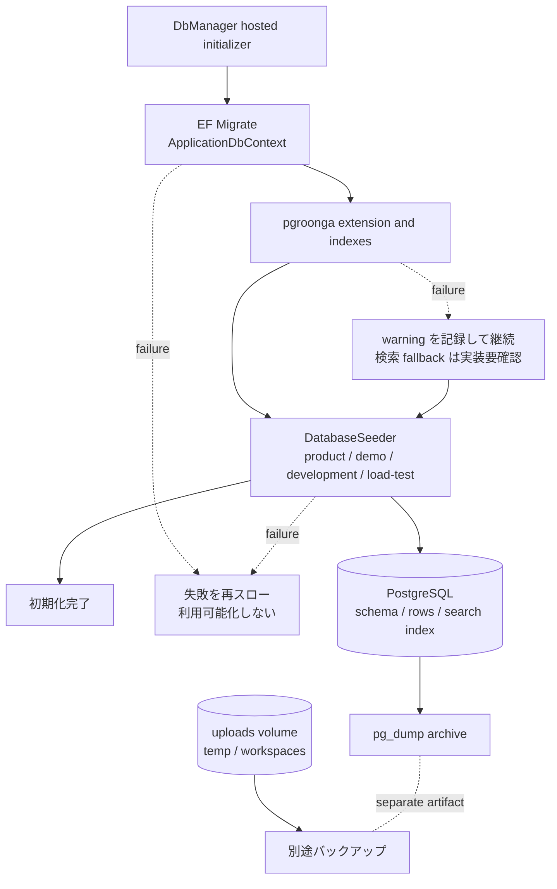

# DB 初期化・検索・整合性・ファイル永続化

## 概要

Coati の DB 利用可能化は、`pecus.DbManager` が同じ `ApplicationDbContext` に対して
スキーマ更新、検索拡張の準備、初期データ投入を行う流れである。検索本文や添付ファイルは
業務テーブルと同じ DB 行にすべて押し込むのではなく、検索用派生データとホスト側ファイル
ストレージに分かれる。本ページでは、この境界と、PostgreSQL の `xmin` を使った楽観的
ロックを中心に扱う。

## DbManager の起動と完了条件

`Program.cs` は `pecusdb` 接続に `ApplicationDbContext` を登録し、migration assembly を
`pecus.DbManager` に固定する。その上で `DbInitializer` を singleton として
`HostedService` に登録するため、DbManager のプロセス開始後に初期化処理が走る
[DbManager Program.cs](../../pecus.DbManager/Program.cs)。

初期化の順序は次の通りである。

1. `DB_RESET_MODE` が `true` の場合だけ、既存 DB を削除する。
2. EF Core の `MigrateAsync` で migration を適用する。
3. `CREATE EXTENSION IF NOT EXISTS pgroonga` と検索インデックス作成を行う。
4. `DatabaseSeeder.SeedAsync` を呼び出す。
5. 成功をログに記録する。Production では `StopApplication()` を呼び、初期化専用
   プロセスを終了する。

migration の失敗と seed の失敗はログ後に再スローされる。したがって「DB は使えるが
seed だけ部分的に失敗した」という完了扱いにはならない。一方、pgroonga の拡張または
インデックス作成だけは warning を出して例外を握りつぶし、初期化を継続する実装である
[DbInitializer.cs](../../pecus.DbManager/DbInitializer.cs)。ヘルスチェックは hosted service の
タスク状態を `Healthy`、`Degraded`（実行中）、`Unhealthy`（失敗またはキャンセル）として
公開する [DbInitializerHealthCheck.cs](../../pecus.DbManager/DbInitializerHealthCheck.cs)。

## モデルと migration の関係

`ApplicationDbContext` の `DbSet` は、ユーザー、組織、ワークスペース、アイテム／タスク、
Activity、チャット、Agenda など、アプリケーションが EF で扱う集約の入口である。
`OnModelCreating` は単なるテーブル名一覧ではなく、主キー、型、ユニーク／複合インデックス、
外部キー、削除動作を定義する。例えば User の login ID・メール、Workspace の code、
UserSetting の UserId には一意性が設定され、Workspace と Organization の関係には
Cascade、Genre や Workspace owner には SetNull が設定されている
[ApplicationDbContext.cs](../../pecus.Libs/DB/ApplicationDbContext.cs)。

この C# モデルを migration として DB に反映するのが `pecus.DbManager/Migrations` の責務で、
`ApplicationDbContextModelSnapshot.cs` は EF が現在のモデルとの差分を次の migration で比較
するためのスナップショットである。snapshot には、例えば Activity の `UserId` の nullable
性、各種検索用インデックス、`xmin` の型と concurrency token 指定まで記録されている
[ApplicationDbContextModelSnapshot.cs](../../pecus.DbManager/Migrations/ApplicationDbContextModelSnapshot.cs)。
従って、DbSet を追加しただけで実 DB が変わるわけではなく、DbManager に migration を
追加して適用する経路が必要になる。

## seed の環境分岐

`DatabaseSeeder` は最初に product の base data を投入し、その戻り値の BackOffice 組織を
開発用 seed に渡す。Demo mode が有効なら demo data を追加する。その後、
`ASPNETCORE_ENVIRONMENT` が `Production` なら development data を投入せず終了する。
Production 以外では `LoadTest` のとき `LoadTestAtoms`、それ以外（通常の development
を含む）は `DeveloperAtoms` を選ぶ [DatabaseSeeder.cs](../../pecus.Libs/DB/Seed/DatabaseSeeder.cs)。
つまり product base は共通の土台、demo は明示的なモード、development と load-test は
別の追加データという分岐であり、seed 値そのものを運用設定の代わりに扱うものではない。

## pgroonga 検索インデックス

起動時に作成対象となるのは、Users の Username／Email 配列、`WorkspaceItemSearchIndices.FullText`、
Skills.Name、WorkspaceTasks.Content の pgroonga index である。WorkspaceItem の検索用行は
本体から派生した `RawBody` と、Subject + Code + TagNames + RawBody を統合した `FullText`
を持つ。派生行を分離することで、本文検索用データの更新が WorkspaceItem 本体の
`xmin` 競合管理に直接影響しない設計意図が示されている
[WorkspaceItemSearchIndex.cs](../../pecus.Libs/DB/Models/WorkspaceItemSearchIndex.cs)。

検索入力は `PgroongaQueryBuilder` が pgroonga query に変換する。スペースは AND グループ、
`|` は OR グループ、混在時は AND の各項の中に OR を作る。また `#` に続く数字だけは
`#123` → `123*` としてアイテムコードの前方一致にする。WorkspaceItemService は検索時に
`FullText &@~ query` を使い、スコア順に ID を取得してから本体を読み込む
[PgroongaQueryBuilder.cs](../../pecus.Libs/Utils/PgroongaQueryBuilder.cs)
／[WorkspaceItemService.cs](../../pecus.WebApi/Services/WorkspaceItemService.cs)。

pgroonga のセットアップに失敗した場合、DbInitializer の warning は fuzzy search を
ILIKE fallback にすると説明している。ただし、確認できた現行の
`GetWorkspaceItemsWithPgroongaAsync` には ILIKE 分岐はなく、非空の検索語は pgroonga
SQL に進む。したがって「pgroonga がない環境でも WorkspaceItem 検索が必ず ILIKE で
動く」とは断定できず、warning とサービス実装の整合は要確認である。検索語が空の場合は
通常の EF クエリ経路になる。

## xmin と 409 Conflict

各対象エンティティの `RowVersion` は `IsRowVersion()` により PostgreSQL のシステム列
`xmin` にマッピングされる。EF はこれを concurrency token として更新条件に含めるため、
読み取り後に別の更新が入ると保存時に競合として検出できる
[ApplicationDbContext.cs](../../pecus.Libs/DB/ApplicationDbContext.cs)
／[migration snapshot](../../pecus.DbManager/Migrations/ApplicationDbContextModelSnapshot.cs)。

サービス側では、更新対象を取得して要求されたバージョンと突き合わせ、競合時に
`IConcurrencyException` 系の例外へ現在のモデルを載せる代表的な経路がある。Web API の
`GlobalExceptionFilter` はこのインターフェースを先に判定し、`statusCode: 409`、
メッセージ、`current`（DB にある最新モデル）を JSON で返す
[GlobalExceptionFilter.cs](../../pecus.WebApi/Filters/GlobalExceptionFilter.cs)。
Frontend の型生成スクリプトは OpenAPI の 409 response の `current` の参照型を抽出し、
エンティティ名と型の union を生成する。これにより画面側は単なる「保存失敗」ではなく、
競合した最新データを型付きで受け取る契約になる
[generate-conflict-types.js](../../pecus.Frontend/scripts/generate-conflict-types.js)。

## User / Activity の外部キーと削除影響

Activity は分析・集計・タイムライン表示用であり、モデル自身が正式な監査ログとは位置づけ
ていない。`UserId` は nullable で、モデル上はシステム操作（NULL）も表現できる
[Activity.cs](../../pecus.Libs/DB/Models/Activity.cs)。User との FK は SetNull なので、
User 行を物理削除できた場合でも Activity 行を残し、actor 参照だけを NULL にできる。
無効化（`IsActive` の変更）では User 行自体が残るため、この SetNull は発生しない。

ただし、ユーザー参照の削除動作を一つの規則へ一般化してはいけない。例えば Workspace の
owner と Organization の所属は SetNull、WorkspaceUser は Cascade、PersonalItemNote の
User は Restrict、ExternalApiKey の CreatedByUser／RevokedByUser は Restrict と、関係ごとに
異なる [ApplicationDbContext.cs](../../pecus.Libs/DB/ApplicationDbContext.cs)。このため
owner、createdBy、uploadedBy などを持つ行が残っていると、個別の User 削除が参照制約で
成功しない場合がある。`UserService.DeleteUserAsync` の存在だけから、あらゆる関連を
安全に削除できるとは言えない。組織全体の物理削除は別経路で、関連 ID をサブクエリで
求め、依存順に batch delete する [BatchOrganizationDeletionService.cs](../../pecus.Libs/DB/Services/BatchOrganizationDeletionService.cs)。

## ファイルデータと DB メタデータ

Web API は `DataPaths:Uploads` を読み、`PecusConfig.FileUpload.StoragePath` に注入する。
本番の migration compose では同じ uploads volume を DbManager にマウントするが、これは
DB の dump 先ではない [WebApi Program.cs](../../pecus.WebApi/Program.cs)
／[migration Compose](../../deploy/docker-compose.migrate.yml)。

添付の作成前アップロードは `{StoragePath}/temp/{workspaceId}/{sessionId}` に置かれ、
アイテム作成時に `WorkspaceItemService` が `PromoteTempFileAsync` を呼ぶ。正式化後は
`workspaces/{workspaceId}/items/{itemId}` にファイルとサムネイルを移動し、DB の
`WorkspaceItemAttachment` にはパス、URL、サイズ、MIME type などのメタデータを保存する
[WorkspaceItemTempAttachmentService.cs](../../pecus.WebApi/Services/WorkspaceItemTempAttachmentService.cs)
／[WorkspaceItemAttachment.cs](../../pecus.Libs/DB/Models/WorkspaceItemAttachment.cs)。

DB backup compose は PostgreSQL に対して `pg_dump` を実行し、dump archive を
`backups/postgres` に置く。一方 uploads は別の volume であるため、DB dump だけでは
添付の実体を復元できない。復旧設計では DB archive と uploads のバックアップ／復元を
別系統の成果物として扱う必要がある [backup Compose](../../deploy/docker-compose.backup.yml)
／[restore helper Compose](../../deploy/docker-compose.restore-helper.yml)。

## 図: 初期化とデータ永続化の境界

図の根拠は、初期化順序と例外方針を定める
[DbInitializer.cs](../../pecus.DbManager/DbInitializer.cs)、DB／添付の分離を定める
[migration Compose](../../deploy/docker-compose.migrate.yml)
および [backup Compose](../../deploy/docker-compose.backup.yml) である。

## 主なコード実体

- 初期化と完了判定: [DbInitializer.cs](../../pecus.DbManager/DbInitializer.cs)、
  [DbInitializerHealthCheck.cs](../../pecus.DbManager/DbInitializerHealthCheck.cs)
- EF モデルと削除動作: [ApplicationDbContext.cs](../../pecus.Libs/DB/ApplicationDbContext.cs)、
  [ApplicationDbContextModelSnapshot.cs](../../pecus.DbManager/Migrations/ApplicationDbContextModelSnapshot.cs)
- seed: [DatabaseSeeder.cs](../../pecus.Libs/DB/Seed/DatabaseSeeder.cs)
- 検索: [PgroongaQueryBuilder.cs](../../pecus.Libs/Utils/PgroongaQueryBuilder.cs)、
  [WorkspaceItemService.cs](../../pecus.WebApi/Services/WorkspaceItemService.cs)
- 競合応答: [GlobalExceptionFilter.cs](../../pecus.WebApi/Filters/GlobalExceptionFilter.cs)、
  [Conflict types generator](../../pecus.Frontend/scripts/generate-conflict-types.js)
- ファイル境界: [WorkspaceItemTempAttachmentService.cs](../../pecus.WebApi/Services/WorkspaceItemTempAttachmentService.cs)、
  [WorkspaceItemAttachment.cs](../../pecus.Libs/DB/Models/WorkspaceItemAttachment.cs)

## 関連ページ

- [実行単位とサービス境界](./00-system-overview.md): DbManager と PostgreSQL の配置境界。
- [Web API・認証・公開契約](./02-webapi-boundary-security.md): 409 を含む API のエラー境界。
- [ユーザーの無効化・履歴とワークスペース業務](./03-user-lifecycle-workspace-domain.md):
  User、Activity、WorkspaceItem の業務上の利用。
- [本番ビルド・デプロイ・運用](./10-deployment-operations.md): backup、volume、migration の運用。

最終確認日: 2026-10-12
