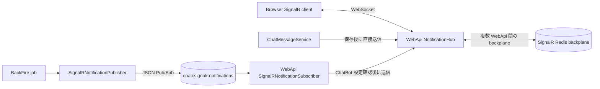

# SignalR・プレゼンス・チャット通知

**最終確認日:** 2026-10-12

## 概要

リアルタイム機能は `pecus.WebApi` が公開する `/hubs/notifications` を中心に構成されています。ブラウザーは公開 Web API URL に直接 SignalR 接続し、サーバーは Hub group、Redis 上の presence、WebApi からの直接送信、BackFire からの Pub/Sub 中継をそれぞれ担います。[WebApi `Program.cs`](../../pecus.WebApi/Program.cs) [`NotificationHub`](../../pecus.WebApi/Hubs/NotificationHub.cs)

このページでは接続とグループ管理、プレゼンス状態、チャット通知の二つの送信経路を説明します。Hangfire の AI 応答処理の詳細と Frontend の session Redis は、それぞれ[バックグラウンド処理と AI/Bot](./06-background-ai-bots.md)と[SSR・セッション・フロントエンド要求経路](./01-frontend-request-session.md)を参照してください。

## ブラウザーから Hub へ接続

Frontend の Server Actions は、公開 API URL に Hub path を付けた接続先と、`ServerSessionManager` から得た有効な access token を返します。ブラウザーの `SignalRProvider` は `accessTokenFactory` からトークンを受け取り、Hub 接続を作ります。[SignalR Actions](../../pecus.Frontend/src/actions/signalr.ts) [SignalRProvider](../../pecus.Frontend/src/providers/SignalRProvider.tsx) [ServerSessionManager](../../pecus.Frontend/src/libs/serverSession.ts)

WebApi は `/hubs/notifications` に [`NotificationHub`](../../pecus.WebApi/Hubs/NotificationHub.cs) を map し、JWT Bearer 設定で Hub の `access_token` を受け取ります。署名、失効状態、ユーザー有効性の検証は通常の JWT 認証 pipeline を通ります。[WebApi `Program.cs`](../../pecus.WebApi/Program.cs)

本番内部 Nginx は `/backend/hubs/` を Hub path に書き換え、アクティブな WebApi slot へ WebSocket Upgrade を転送します。[Nginx routing](../../deploy/nginx/conf.d/10-coati.conf) Blue/Green の詳細は[本番ビルド・デプロイ・運用](./10-deployment-operations.md)を参照してください。

## Hub group と membership

Hub は user、organization、workspace、item、task、chat の各 group に接続を参加させます。接続時に JWT の user／organization 情報から個人・組織 group に参加し、workspace／item／task の参加では有効な workspace member かを確認します。task の参加では対象 task が指定 workspace に属することも検査し、chat room は `ChatRoomMembers` を通じて参加権を確認します。[`NotificationHub`](../../pecus.WebApi/Hubs/NotificationHub.cs)

Hub の参加 method は対象ごとに検証と遷移動作が異なります。workspace/item/task 参加を単なる client-side subscription とみなさず、Membership 確認や以前の対象からの離脱を伴う処理として扱います。接続復帰後に必要な workspace 等への再参加は、Frontend hooks が行います。[`useSignalR`](../../pecus.Frontend/src/hooks/useSignalR.ts)

## Presence と編集状態

[`SignalRPresenceService`](../../pecus.WebApi/Services/SignalRPresenceService.cs) は backend Redis の DB 2 を利用します。接続から user／workspace／item／task／organization への対応は String、対象ごとの接続一覧は Set、編集者情報は Hash 等で保持し、接続状態には TTL を設定します。切断時には service が対象キーを削除します。

タスク編集状態の取得では Redis Lua script を使い、既存の別ユーザー編集者がいる場合は設定を拒否し、そうでなければ editor Hash と逆引き情報を設定します。これは SignalR 上の協調表示状態であり、DB 更新の同時実行制御や業務データ保存を保護するロックではありません。DB の xmin／409 競合制御は[DB 初期化・検索・整合性・ファイル永続化](./04-data-lifecycle-search-concurrency.md)を参照してください。[`SignalRPresenceService`](../../pecus.WebApi/Services/SignalRPresenceService.cs)

WebApi の SignalR Redis backplane は、複数の WebApi インスタンス間で SignalR group 配信を橋渡しします。これは BackFire の通知メッセージ転送に用いる独自 Pub/Sub channel とは別機能です。[WebApi `Program.cs`](../../pecus.WebApi/Program.cs)

## WebApi 内のリアルタイム通知

[`ChatMessageService`](../../pecus.WebApi/Services/ChatMessageService.cs) は chat message と関連するメンション情報を保存した後、`IHubContext<NotificationHub>` を通じて SignalR group に通知を送ります。system room は組織 group、それ以外の room は room group と組織 group に通知し、メンション通知は対象ユーザー group に送られます。

通知は `ReceiveNotification` を使い、event type と payload を持ちます。Frontend の SignalR provider が受け取り、event type に対応する登録済み handler へ渡します。[`SignalRProvider`](../../pecus.Frontend/src/providers/SignalRProvider.tsx)

## BackFire からの通知中継

BackFire は `SignalRNotificationPublisher` から通知を JSON 化して Redis Pub/Sub channel `coati:signalr:notifications` に publish します。WebApi の [`SignalRNotificationSubscriber`](../../pecus.WebApi/Services/SignalRNotificationSubscriber.cs) は同じ channel を購読し、`IHubContext` から指定 group に転送します。[Publisher](../../pecus.Libs/Notifications/SignalRNotificationPublisher.cs) [BackFire `Program.cs`](../../pecus.BackFire/Program.cs)

ChatBot source の通知については、subscriber が organization ID を確認し、該当組織の生成 AI 設定を確認してから送信します。条件に合わない場合や設定確認に失敗した場合は、その通知を SignalR に送らない処理です。Pub/Sub は永続キューではなく、購読者がいない場合の再送を保証する仕組みはこの経路にはありません。[`SignalRNotificationSubscriber`](../../pecus.WebApi/Services/SignalRNotificationSubscriber.cs)

## チャット送信と AI／グループ返信 job の分岐

Chat API は room membership を確認し、[`ChatMessageService`](../../pecus.WebApi/Services/ChatMessageService.cs) でメッセージを保存・通知した後、room type に応じて AI または group reply job を enqueue します。HTTP 応答が返る時点では返信 job の完了を待たず、返信生成は BackFire の Hangfire worker が処理します。[`ChatController`](../../pecus.WebApi/Controllers/ChatController.cs) [Frontend chat actions](../../pecus.Frontend/src/actions/chat.ts)

AI client の選択、prompt/context の構築や Bot 返信内容の保存は[Hangfire・AI クライアント・Bot](./06-background-ai-bots.md)を参照してください。

## 図: 通知の二つの経路

直接送信と Pub/Sub 中継はどちらも最終的には WebApi の SignalR group に到達します。一方、SignalR backplane は WebApi instance 間の group 配信を担い、Pub/Sub channel は BackFire から WebApi への通知依頼を運びます。Hangfire の永続 job storage とも区別してください。[WebApi `Program.cs`](../../pecus.WebApi/Program.cs) [Publisher](../../pecus.Libs/Notifications/SignalRNotificationPublisher.cs) [Subscriber](../../pecus.WebApi/Services/SignalRNotificationSubscriber.cs)

## 主なコード実体

| 責務 | 実装 |
|---|---|
| Hub 登録・認証・Redis backplane | [WebApi `Program.cs`](../../pecus.WebApi/Program.cs)、[`NotificationHub`](../../pecus.WebApi/Hubs/NotificationHub.cs) |
| Presence・編集状態 | [`SignalRPresenceService`](../../pecus.WebApi/Services/SignalRPresenceService.cs) |
| WebApi 内通知 | [`ChatMessageService`](../../pecus.WebApi/Services/ChatMessageService.cs) |
| Pub/Sub 中継 | [Publisher](../../pecus.Libs/Notifications/SignalRNotificationPublisher.cs)、[Subscriber](../../pecus.WebApi/Services/SignalRNotificationSubscriber.cs) |
| ブラウザー接続 | [SignalR Actions](../../pecus.Frontend/src/actions/signalr.ts)、[SignalRProvider](../../pecus.Frontend/src/providers/SignalRProvider.tsx) |

## 関連ページ

- [実行単位とサービス境界](./00-system-overview.md)
- [SSR・セッション・フロントエンド要求経路](./01-frontend-request-session.md)
- [ユーザー・組織・ワークスペース・アイテム・タスク](./03-user-lifecycle-workspace-domain.md)
- [DB 初期化・検索・整合性・ファイル永続化](./04-data-lifecycle-search-concurrency.md)
- [Hangfire・AI クライアント・Bot](./06-background-ai-bots.md)
- [本番ビルド・デプロイ・運用](./10-deployment-operations.md)
