# Hangfire・AI クライアント・Bot

## 概要

Coati では、HTTP 要求の中で完了させる処理と、Hangfire に登録して後続の worker に実行させる処理を分けています。WebApi は Hangfire のクライアントとしてジョブを Redis に enqueue し、`pecus.BackFire` は同じ Hangfire storage を使う server としてジョブを実行します。定期ジョブも BackFire の起動時に登録されます。

AI/Bot の返信はこの非同期経路の一例です。チャット投稿を DB に保存した後、WebApi が `AiChatReplyTask` を enqueue し、BackFire が組織設定を検査して AI クライアント、Bot、必要なコンテキストを組み立てます。生成した返信は DB に保存され、別用途の Redis Pub/Sub を経由して WebApi の SignalR 接続へ通知されます。Hangfire のジョブ保存と Pub/Sub 通知は、同じ Redis サービスを使っていても別の役割です。

**主なコード実体:** [`pecus.BackFire/Program.cs`](../../pecus.BackFire/Program.cs)、[`HangfireTaskExtensions`](../../pecus.Libs/Hangfire/Tasks/Extensions/HangfireTaskExtensions.cs)、[`AiClientFactory`](../../pecus.Libs/AI/AiClientFactory.cs)、[`AiToolsExtensions`](../../pecus.Libs/AI/Extensions/AiToolsExtensions.cs)、[`AiChatReplyTask`](../../pecus.Libs/Hangfire/Tasks/Bot/AiRoom/AiChatReplyTask.cs)。

## Hangfire producer と worker

WebApi と BackFire は、Redis 上の Hangfire storage を共有します。WebApi の `Program.cs` は `AddHangfire` で Hangfire クライアントを登録し、Redis storage に `hangfire:` prefix と DB 1 を指定します。BackFire も同じ prefix／DB を指定した storage を作成し、`AddHangfireServer` を呼び出して実行 worker を起動します。したがって、WebApi の `IBackgroundJobClient.Enqueue(...)` はジョブを登録する producer 側の処理であり、ジョブ本体の実行は BackFire 側の責務です。WebApi では `AddHangfireServer` を呼び出していません。

BackFire の worker 数は `Environment.ProcessorCount * WorkerCountPerCore` で計算されます。設定値の取得キーは `WorkerPerCore`、コード上の既定値は 2 です。worker は BackFire の起動プロセス内で構成され、個々のタスクは DI に登録されたクラスとして実行時に解決されます。開発環境では BackFire の Hangfire dashboard も公開されますが、dashboard の有効化は worker の登録とは別で、Development 環境に限定されています。

根拠: [WebApi の Hangfire／Redis 登録](../../pecus.WebApi/Program.cs)、[BackFire の storage・server・worker 数・dashboard](../../pecus.BackFire/Program.cs)、[Hangfire タスクの DI 登録](../../pecus.Libs/Hangfire/Tasks/Extensions/HangfireTaskExtensions.cs)。

## one-off job と recurring scheduler

### 要求から enqueue する job

たとえばチャット投稿 API は、ルームメンバーであることを確認し、送信者 Actor を特定してメッセージを保存してからルーム種別を確認します。AI ルームなら `AiChatReplyTask.SendReplyAsync`、グループルームなら `GroupChatReplyTask.SendReplyAsync` を `IBackgroundJobClient.Enqueue` で登録します。enqueue の引数には組織 ID、ルーム ID、保存済みメッセージ ID、送信者ユーザー ID が渡されます。API は AI 応答をその場で待たず、保存済みメッセージを応答として返します。

BackFire の [`AddHangfireTasks`](../../pecus.Libs/Hangfire/Tasks/Extensions/HangfireTaskExtensions.cs) は、アクティビティ記録、メール、画像、クリーンアップ、アップロード、ワークスペースアイテム、Bot 返信、アイテム／タスク作成・更新、通知などのタスクを DI に登録します。ここでの登録は worker がジョブ型を解決できるようにするもので、enqueue の呼び出し元そのものではありません。実際の要求側の enqueue 例と、アクティビティ記録・メール送信などのタスク実装は以下を参照してください。

- [チャット投稿と AI／グループ返信の enqueue](../../pecus.WebApi/Controllers/ChatController.cs)
- [ActivityTasks](../../pecus.Libs/Hangfire/Tasks/ActivityTasks.cs)
- [EmailTasks](../../pecus.Libs/Hangfire/Tasks/EmailTasks.cs)
- [CleanupTasks](../../pecus.Libs/Hangfire/Tasks/CleanupTasks.cs)
- [WorkspaceItemTasks](../../pecus.Libs/Hangfire/Tasks/WorkspaceItemTasks.cs)

### 起動時に登録する recurring job

BackFire はサービス構築後に `IRecurringJobManager` を取得し、各 scheduler の `Configure...` を呼び出します。scheduler は対応する設定 section をクラスへバインドし、`Enabled` が false の場合は登録済みの recurring job ID を削除して終了します。有効な場合は `AddOrUpdate` で job ID、呼び出すタスクと Cron 式を登録します。つまり、定期ジョブの登録点は WebApi 要求時ではなく BackFire 起動時です。クリーンアップ群は同じ scheduler から複数の recurring job を登録し、アップロード領域のパスが設定されていない場合は該当 job を登録しません。また、チャット履歴クリーンアップは対象カテゴリがすべて無効なら登録を見送ります。

| scheduler | 登録対象・コード上の既定スケジュール例 | 設定・登録上の補足 |
| --- | --- | --- |
| [WeeklyReportJobScheduler](../../pecus.BackFire/Services/WeeklyReportJobScheduler.cs) | 毎日、設定された配信時刻に確認を実行 | Enabled を確認し、時・分を有効範囲に丸める。処理本体は配信対象組織ごとのレポート job を enqueue する。 |
| [SystemNotificationJobScheduler](../../pecus.BackFire/Services/SystemNotificationJobScheduler.cs) | 毎分 | 無効なら `SystemNotificationDelivery` を削除する。 |
| [AchievementJobScheduler](../../pecus.BackFire/Services/AchievementJobScheduler.cs) | 毎日 03:00 UTC | UTC timezone を明示し、無効時は `AchievementEvaluation` を削除する。 |
| [LandingPageRecommendationJobScheduler](../../pecus.BackFire/Services/LandingPageRecommendationJobScheduler.cs) | 毎週月曜 04:00 UTC | UTC timezone を明示し、無効時は `LandingPageRecommendation` を削除する。 |
| [AgendaReminderJobScheduler](../../pecus.BackFire/Services/AgendaReminderJobScheduler.cs)、[AgendaEmailJobScheduler](../../pecus.BackFire/Services/AgendaEmailJobScheduler.cs) | 各 5 分ごと | 個別に Enabled と Cron 式を読み、無効なら対応する ID を削除する。 |
| [CleanupJobScheduler](../../pecus.BackFire/Services/CleanupJobScheduler.cs) | 各 cleanup 設定の Cron 式 | refresh token、device、email-change token、chat、uploads、agenda、external API key を別々の recurring job として管理する。個別の登録条件もある。 |

ここに記した時刻・間隔はコード上の既定値の例です。実行時の設定値やメール／AI の秘密情報を示すものではありません。Agenda の繰り返し予定や reminder の業務上の判定、Focus のタスク選定は本ページの対象外です。詳細は[アジェンダ・Focus・実績](07-agenda-focus-achievements.md)を参照してください。

## AI provider abstraction

`IAiClientFactory` は二つの生成経路を持ちます。`GetDefaultClient()` はシステム既定の provider・API key・model を設定から読み、provider が未指定、key が空、model が空の場合は例外にします。`CreateClient(vendor, apiKey, model)` は呼び出し元が渡した組織別の値を受け取り、vendor に対応するクライアントを生成します。`None` や未対応 vendor では `null` を返します。対応する provider は OpenAI、Anthropic、Google Gemini、DeepSeek、Kimi です。ここでは設定の仕組みだけを示し、設定値・キーの内容は掲載しません。

WebApi と BackFire の起動コードは provider ごとの設定／HTTP client 登録拡張を呼び出し、`AddAiClientFactory` により factory を DI に登録します。既定の AI client 登録は必要な既定 provider・key・model が揃っている場合に有効化されます。一方、AI 返信 job は組織の `OrganizationSettings` から provider・model・key を読み、`BotTaskGuard` で provider が `None` でないことと必須値の存在を確認してから factory に渡します。API 呼び出し先や認証値は設定と provider client の境界に閉じており、タスク本体は `IAiClient` を介して生成を依頼します。

根拠: [IAiClientFactory](../../pecus.Libs/AI/IAiClientFactory.cs)、[AiClientFactory](../../pecus.Libs/AI/AiClientFactory.cs)、[factory DI 登録](../../pecus.Libs/AI/Extensions/AiClientFactoryExtensions.cs)、[provider 拡張の例](../../pecus.Libs/AI/Extensions/OpenAIServiceExtensions.cs)、[既定 client の登録条件](../../pecus.Libs/AI/Extensions/DefaultAiServiceExtensions.cs)、[組織設定の Bot guard](../../pecus.Libs/Hangfire/Tasks/Bot/Guards/BotTaskGuard.cs)。

## AI Tools と context 構築

BackFire は `AddMessageAnalyzer`、`AddAiTools` と Focus／information／task assignment provider を DI に登録します。`AddAiTools` が `IAiTool` として登録するのは、ユーザー／チームのタスク情報を扱う `GetUserTasksTool`、ワークスペース情報を探す `SearchInformationTool`、類似タスクの経験者を提案する `SuggestSimilarTaskExpertsTool` です。各 tool は定義、適用スコア、実行処理を持ち、`AiToolExecutor` が候補をスコア順に絞り、結果プロンプトと推奨ロールを集約します。

AI ルームの返信では `AiChatReplyTask` がメッセージ analyzer で投稿文を分析し、結果が中立ならツールによる context 取得をスキップします。それ以外ではユーザー ID、組織 ID、ユーザー timezone、元の投稿、分析結果を `AiToolContext` に組み立てて executor に渡します。返信タスクの自動選択は関連度スコア 50 以上、最大 2 tool です。`GetUserTasksTool` は Focus provider から自分またはチームのタスクを取得し、組織 ID がある場合は今日の Agenda 情報も加えます。`SearchInformationTool` は情報検索 provider にユーザー ID と検索トピックを渡し、アクセス可能な workspace の情報を応答 context に整形します。`SuggestSimilarTaskExpertsTool` は task assignment suggester を利用しますが、現在の sentiment には対応する自動選択スコアがないため `CalculateRelevanceScore` は 0 です。このため、返信タスクの score 50 以上という自動選択経路では選ばれません。tool executor は名前で実行する API も持ちますが、ここで追った返信処理は score に基づく `ExecuteAsync` の経路です。

これらの provider は AI の入力 context を用意する境界であり、Focus score や Agenda recurrence の業務仕様を本ページでは展開しません。関連するデータ・検索や詳細な Focus 説明は[DB／検索](04-data-lifecycle-search-concurrency.md)および[アジェンダ・Focus・実績](07-agenda-focus-achievements.md)を参照してください。

根拠: [Analyzer 登録](../../pecus.Libs/AI/Extensions/MessageAnalyzerExtensions.cs)、[Tool 登録](../../pecus.Libs/AI/Extensions/AiToolsExtensions.cs)、[IAiTool](../../pecus.Libs/AI/Tools/IAiTool.cs)、[AiToolContext](../../pecus.Libs/AI/Tools/AiToolContext.cs)、[AiToolExecutor](../../pecus.Libs/AI/Tools/AiToolExecutor.cs)、[GetUserTasksTool](../../pecus.Libs/AI/Tools/Implementations/GetUserTasksTool.cs)、[FocusTaskProvider](../../pecus.Libs/Focus/FocusTaskProvider.cs)、[AgendaProvider](../../pecus.Libs/Focus/AgendaProvider.cs)、[SearchInformationTool](../../pecus.Libs/AI/Tools/Implementations/SearchInformationTool.cs)、[IInformationSearchProvider](../../pecus.Libs/Information/IInformationSearchProvider.cs)、[InformationSearchProvider](../../pecus.Libs/Information/InformationSearchProvider.cs)、[SuggestSimilarTaskExpertsTool](../../pecus.Libs/AI/Tools/Implementations/SuggestSimilarTaskExpertsTool.cs)、[TaskAssignmentSuggester](../../pecus.Libs/Hangfire/Tasks/Services/TaskAssignmentSuggester.cs)。

## Chat Bot reply pipeline

AI ルームの返信 job は、WebApi から BackFire へ渡る ID を入口にして、DB、AI、Bot、通知の各境界を次の順に通ります。

1. **enqueue 済みの投稿を特定:** [`ChatController.SendMessage`](../../pecus.WebApi/Controllers/ChatController.cs) が投稿を保存した後に、組織 ID・room ID・trigger message ID・sender user ID を `AiChatReplyTask.SendReplyAsync` に渡します。job の実行開始時には `AiChatReplyTask` が既定の ChatBot を先に取得し、その後の処理に入ります。
2. **組織設定を guard:** `BotTaskGuard.IsBotEnabledAsync` が組織設定を確認します。vendor が `None`、API key または model が空なら返信処理をスキップします。
3. **AI client を作成し、トリガー投稿を読む:** guard が返した provider・model・key を `IAiClientFactory.CreateClient` に渡します。client が作れなければ終了し、作成できた場合は trigger message を DB から取得します。
4. **返信 Bot を選択:** 入力品質の分析結果による分岐、ランダム選択、会話履歴に基づく選択を試みます。選択できない場合は Bot type 判定へフォールバックします。会話履歴は直近 2 日の最大 10 メッセージを対象に構築されます。
5. **入力 context と prompt を構築:** Bot の既読・入力中状態を通知し、投稿文の分析結果に応じて AI Tools から Focus／Agenda／情報 context を得ます。利用可能な context と会話履歴をメッセージに組み合わせ、選択した Bot の persona・role・constraint から system prompt を構築します。入力品質判定で特別な分岐になった場合は、会話 context を組み立てず元投稿を使う経路があります。
6. **AI 生成結果を永続化:** `GenerateTextWithMessagesAsync` の結果を Bot の `ChatMessage` として保存し、ルームの `UpdatedAt` を更新します。
7. **通知を別経路へ渡す:** 保存後、publisher がチャットメッセージ受信イベントと未読更新イベントを Redis Pub/Sub に publish します。失敗時は入力中状態を解除し、エラー通知を試みてから例外を再送出します。

この job は bot guard とデータ保存を担当し、ブラウザーへの SignalR 配信は publisher／WebApi subscriber の境界に渡します。SignalR の接続、Hub、presence、グループの詳細は[SignalR・プレゼンス・チャット通知](05-realtime-chat-notifications.md)に委譲します。

根拠: [ChatController.SendMessage](../../pecus.WebApi/Controllers/ChatController.cs)、[AiChatReplyTask](../../pecus.Libs/Hangfire/Tasks/Bot/AiRoom/AiChatReplyTask.cs)、[BotTaskGuard](../../pecus.Libs/Hangfire/Tasks/Bot/Guards/BotTaskGuard.cs)、[SignalRNotificationPublisher](../../pecus.Libs/Notifications/SignalRNotificationPublisher.cs)。

## 図: producer・storage・worker と通知の経路

```mermaid
flowchart LR
    API["WebApi<br/>Hangfire producer"]
    REDIS["Redis<br/>Hangfire storage<br/>DB 1 / prefix hangfire:"]
    WORKER["BackFire<br/>Hangfire server / workers"]
    TASK["AiChatReplyTask<br/>AI生成・DB保存"]
    PUB["SignalRNotificationPublisher"]
    CHANNEL["Redis Pub/Sub<br/>coati:signalr:notifications"]
    SUB["WebApi<br/>SignalRNotificationSubscriber"]
    HUB["SignalR Hub<br/>接続クライアントへ転送"]

    API -->|"Enqueue: job を登録"| REDIS
    REDIS -->|"queued job を取得"| WORKER
    WORKER --> TASK
    TASK --> PUB
    PUB -->|"publish"| CHANNEL
    CHANNEL -->|"subscribe"| SUB
    SUB --> HUB
```

図の Hangfire storage はジョブを登録・取得する経路であり、Pub/Sub channel は BackFire などの publisher が通知を WebApi へ渡す経路です。Pub/Sub の payload は Hangfire のジョブデータではありません。また、WebApi は SignalR の Redis backplane も `coati-signalr` の channel prefix で構成していますが、これはこのページで示す独自 Pub/Sub channel と同じ仕組み・用途ではありません。ブラウザーへの転送と backplane の詳細は[リアルタイム通知のページ](05-realtime-chat-notifications.md)を参照してください。

根拠: [WebApi の Hangfire と SignalR Redis 登録](../../pecus.WebApi/Program.cs)、[BackFire の Hangfire server](../../pecus.BackFire/Program.cs)、[通知 publisher](../../pecus.Libs/Notifications/SignalRNotificationPublisher.cs)、[通知 subscriber](../../pecus.WebApi/Services/SignalRNotificationSubscriber.cs)。

## 関連ページ

- [実行単位とサービス境界](00-system-overview.md) — WebApi／BackFire と Redis の配置上の境界。
- [DB 初期化・検索・整合性・ファイル永続化](04-data-lifecycle-search-concurrency.md) — job や AI Tools が参照・更新する DB／検索の境界。
- [SignalR・プレゼンス・チャット通知](05-realtime-chat-notifications.md) — Pub/Sub subscriber から SignalR への配信経路。
- [アジェンダ・Focus・実績](07-agenda-focus-achievements.md) — Agenda、Focus、実績の業務上の処理。
- [ローカル開発・設定・API／型生成](09-local-development-code-generation.md) — サービスを開発環境で構成・起動する流れ。

---

最終確認日: 2026-10-12
