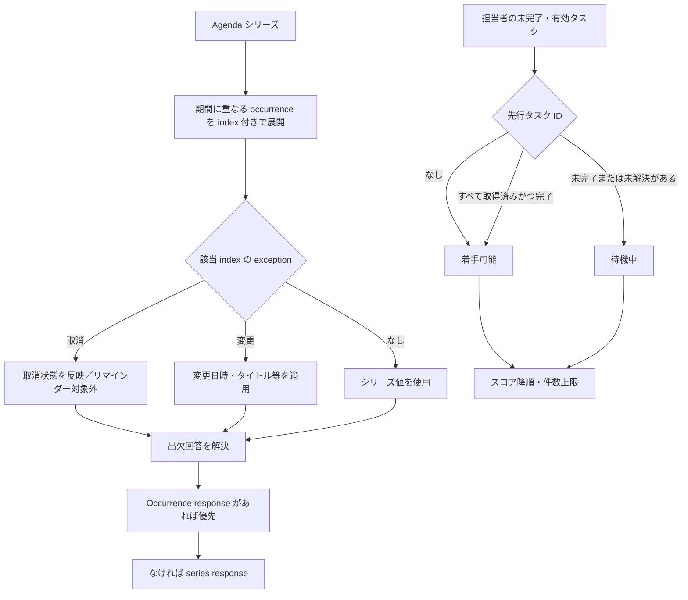

# アジェンダ・Focus・実績

## 概要

このページでは、アジェンダのシリーズから個々の開催回（occurrence）を展開する処理、Focus が候補タスクを選別・採点する処理、およびそれらを利用する AI ツールと定期処理の境界を説明します。アジェンダのシリーズ・例外・出欠回答は DB 上のモデルとして保持され、期間指定 API やリマインダー処理が開催回に展開します。[Agenda モデル](../../pecus.Libs/DB/Models/Agenda.cs) [AgendaService](../../pecus.WebApi/Services/AgendaService.cs) [RecurrenceHelper](../../pecus.Libs/RecurrenceHelper.cs)

Focus は担当者の未完了タスクを抽出し、先行タスクの完了状況で「着手可能」と「待機中」に分けたうえで、優先度・期限・後続タスク数から順位を付けます。[FocusTaskProvider](../../pecus.Libs/Focus/FocusTaskProvider.cs) [TaskScoreCalculator](../../pecus.Libs/Focus/TaskScoreCalculator.cs)

## Agenda のシリーズと occurrence

`Agenda` はシリーズの基本情報を1件として保存します。開始・終了は `DateTimeOffset`（モデルの説明では UTC）、繰り返し種別・間隔・月内週番号・終了日または回数がシリーズ側の属性です。繰り返し種別には日次、週次、隔週、日付指定の月次、曜日指定の月次、年次があります。[Agenda モデル](../../pecus.Libs/DB/Models/Agenda.cs) [RecurrenceType](../../pecus.Libs/DB/Models/Enums/RecurrenceType.cs)

`RecurrenceHelper.ExpandOccurrencesWithIndex` は指定期間に重なる開催回を、0 始まりの `Index` と開始日時で返します。単発予定は index 0 です。繰り返し回数が指定されない場合は、展開上限として開始日から2年を使い、1回の呼び出しで最大365件までに制限します。週次は `RecurrenceInterval` 週ごとに進みますが、隔週の分岐は常に14日を加算します。作成・更新時の検証は間隔を1〜99、回数を1〜999とし、終了日と回数の同時指定を拒否します。[RecurrenceHelper](../../pecus.Libs/RecurrenceHelper.cs)

特定回だけの取消・変更は、シリーズとは別の `AgendaException` に `OccurrenceIndex` をキーとして保存します。開催回の展開後に対応する例外を適用し、取消ならその回を除外するか `IsCancelled` を付け、変更なら開始・終了、タイトル、場所などの上書きを反映します。シリーズの繰り返し種別・間隔・月内週番号のいずれか、または開始日時が更新された場合、既存例外は削除されます。[AgendaException モデル](../../pecus.Libs/DB/Models/AgendaException.cs) [AgendaService](../../pecus.WebApi/Services/AgendaService.cs) [ApplicationDbContext](../../pecus.Libs/DB/ApplicationDbContext.cs)

通常の一覧 API はシリーズ単位の応答で、`GET /api/agendas/occurrences` は期間内の開催回を展開して返します。展開レスポンスには例外による取消・変更と出欠状態が反映されます。出欠状態は、開催回固有の回答があればシリーズ全体への回答より優先し、固有回答がなければシリーズ全体の回答を使用します。モデルでは `OccurrenceIndex = null` がシリーズ全体の回答を表します。[AgendasController](../../pecus.WebApi/Controllers/AgendasController.cs) [AgendaService](../../pecus.WebApi/Services/AgendaService.cs) [AgendaAttendanceResponse モデル](../../pecus.Libs/DB/Models/AgendaAttendanceResponse.cs)

### タイムゾーンの境界

`Agenda` に保存されるのは日時の `DateTimeOffset` であり、シリーズ固有の IANA タイムゾーン ID はありません。`RecurrenceHelper` は開始日時のオフセットを保って日時を進めます。したがって、タイムゾーン規則に基づいて夏時間の切り替わり後も同じ現地時刻を保つ変換を、このヘルパー自身が行うわけではありません。[Agenda モデル](../../pecus.Libs/DB/Models/Agenda.cs) [RecurrenceHelper](../../pecus.Libs/RecurrenceHelper.cs)

一方、AI 用 `AgendaProvider` はユーザーのタイムゾーンを引数に取り、その現地日付の開始から翌日までを対象期間として予定を取得します。タイムゾーンの解決に失敗した場合、日付境界の計算には既定の `Asia/Tokyo`（それも解決できなければ UTC）を使います。AI ツールは取得した日時をユーザーのタイムゾーンで時刻表示します。ただし表示時は `TimeZoneInfo.FindSystemTimeZoneById` に元の ID を渡すため、プロバイダーの日付境界計算と同じフォールバックが適用されるわけではありません。`UserSetting.TimeZone` 自体もモデル上「TODO：未使用」と記載されており、このツールの値は `AiToolContext.UserTimeZone` から渡されます。[AgendaProvider](../../pecus.Libs/Focus/AgendaProvider.cs) [TimeZoneUtils](../../pecus.Libs/Utils/TimeZoneUtils.cs) [GetUserTasksTool](../../pecus.Libs/AI/Tools/Implementations/GetUserTasksTool.cs) [AiToolContext](../../pecus.Libs/AI/Tools/AiToolContext.cs) [UserSetting モデル](../../pecus.Libs/DB/Models/UserSetting.cs)

## リマインダーから通知メールまで

BackFire の `AgendaReminderJobScheduler` は設定で有効な場合、既定で5分ごとに `AgendaReminderTask.ProcessRemindersAsync` を登録します。タスクは現在から25時間先までを対象に予定を取得し、繰り返し予定を開催回に展開します。シリーズまたは特定回の取消を除き、変更例外の開始日時を使って、開催前の参加者ごとに個人設定（なければシリーズ既定）のリマインダーを判定します。シリーズまたは開催回への出欠回答が「不参加」なら、その参加者への送信をスキップします。[AgendaReminderJobScheduler](../../pecus.BackFire/Services/AgendaReminderJobScheduler.cs) [AgendaReminderTask](../../pecus.Libs/Hangfire/Tasks/AgendaReminderTask.cs) [AgendaAttendee モデル](../../pecus.Libs/DB/Models/AgendaAttendee.cs)

リマインダー時刻が現在から5分以内なら通常の対象となり、時刻を過ぎていても開催前なら再起動・遅延後の取りこぼし回復として対象になります。送信処理は、まず `AgendaNotification`（種別 `Reminder`、メール未送信）を作成し、同じユーザー・開催回・リマインダー分数の `AgendaReminderLog` を同時に保存します。重複防止は、送信前にログの存在を照会するチェックと、DB の `(AgendaId, UserId, OccurrenceStartAt, MinutesBefore)` 一意インデックスの二段階です。後者は同じキーのログが重複して永続化されるのを防ぎますが、並行実行をロックする処理ではありません。並行実行で事前照会が競合した場合、一意制約違反になり得るため、ここから「必ず一度だけ成功する」配送保証までは導けません。[AgendaReminderTask](../../pecus.Libs/Hangfire/Tasks/AgendaReminderTask.cs) [AgendaReminderLog モデル](../../pecus.Libs/DB/Models/AgendaReminderLog.cs) [ApplicationDbContext](../../pecus.Libs/DB/ApplicationDbContext.cs)

メール送信はリマインダータスクから直接行わず、別の `AgendaEmailJobScheduler` が既定5分ごとに `AgendaEmailTask` を起動します。後者は `IsEmailSent == false` の通知を作成日時順に最大100件取得し、ユーザーのメール設定などを確認して送信します。デモ組織、ダミーアドレス、メール設定による除外は送信済み扱いになります。リマインダーは開催時刻の既定5分前を過ぎていればメールを送らず、その通知を処理済みにします。これにより、アプリ内通知の作成とメール配信のキュー処理は別々の段階になります。[AgendaEmailJobScheduler](../../pecus.BackFire/Services/AgendaEmailJobScheduler.cs) [AgendaEmailTask](../../pecus.Libs/Hangfire/Tasks/AgendaEmailTask.cs) [AgendaNotification モデル](../../pecus.Libs/DB/Models/AgendaNotification.cs)

## Focus task の候補抽出と分類

通常の Focus 候補は、指定ユーザーが担当するタスクのうち、未完了・未破棄で、アイテムがアクティブかつ未アーカイブ、所属ワークスペースも存在してアクティブなものです。クエリに明示的な組織 ID 条件はなく、候補の範囲は担当ユーザーとアイテム／ワークスペース状態で決まります。[FocusTaskProvider](../../pecus.Libs/Focus/FocusTaskProvider.cs) [WorkspaceTask モデル](../../pecus.Libs/DB/Models/WorkspaceTask.cs)

候補タスクの `PredecessorTaskIds` が空、または参照先の先行タスクがすべて見つかり、すべて完了済みなら `CanStart` として「着手可能」に分類します。未完了の先行タスクがある場合や、参照先が取得できない場合は着手可能にならず「待機中」に分類されます。待機中タスクには、取得できた最初の未完了先行タスクのアイテムコードと内容が表示用に付与されます。各分類内ではスコア降順に並べ、それぞれ指定件数まで返します。[FocusTaskProvider](../../pecus.Libs/Focus/FocusTaskProvider.cs) [WorkspaceTask モデル](../../pecus.Libs/DB/Models/WorkspaceTask.cs)

後続影響の計算では、候補タスクの ID を先行 ID 配列に含むタスクのうち、未完了・未破棄のものを数えます。`FocusController` 経由の API はユーザー設定から `FocusScorePriority` と表示上限を読み、未設定時はいずれも期限重視・5件を使います。AI の `get_user_tasks` ツールも同じ provider を利用しますが、通常の自分のタスク取得は provider の既定（期限重視）とツール側の上限を指定し、API のユーザー設定をこの呼び出しで読み込む構成ではありません。[FocusTaskProvider](../../pecus.Libs/Focus/FocusTaskProvider.cs) [FocusRecommendationService](../../pecus.WebApi/Services/FocusRecommendationService.cs) [FocusController](../../pecus.WebApi/Controllers/FocusController.cs) [GetUserTasksTool](../../pecus.Libs/AI/Tools/Implementations/GetUserTasksTool.cs)

## Focus scoring

`TaskScoreCalculator` の総合点は次式です。ソースで現在定義されている優先度スコアは Critical=4、High=3、Medium=2、Low=1、null=1 です（`WorkspaceTask` のコメント上の null 説明とは異なります）。期限スコアは現在時刻との差で、期限超過=10、24時間以内=8、48時間以内=6、72時間以内=4、7日以内=3、14日以内=2、それより先=1 です。後続タスク数は0件=0、1件=3、2件=6、3件以上=10に変換します。[TaskScoreCalculator](../../pecus.Libs/Focus/TaskScoreCalculator.cs) [WorkspaceTask モデル](../../pecus.Libs/DB/Models/WorkspaceTask.cs)

```text
総合点 = 優先度スコア × 優先度重み
       + 期限スコア × 期限重み
       + 後続影響スコア × 後続影響重み
```

ユーザー設定の `FocusScorePriority` に対応する現在の重みは、優先度重視が `(4, 3, 5)`、期限重視が `(2, 5, 5)`、後続影響重視が `(2, 3, 7)`（順に優先度・期限・後続影響）です。未知値も `(2, 3, 5)` にフォールバックします。タスクの優先度、期限、後続数の各スコアを作ってからこの重みで合算する実装が、Focus の順位付けに使われます。[TaskScoreCalculator](../../pecus.Libs/Focus/TaskScoreCalculator.cs) [FocusScorePriority](../../pecus.Libs/DB/Models/Enums/FocusScorePriority.cs) [FocusRecommendationService](../../pecus.WebApi/Services/FocusRecommendationService.cs)

## AI、landing recommendation、実績判定の接点

AI の `get_user_tasks` ツールは、`IFocusTaskProvider` から自分またはチームのタスクを取得し、組織 ID がある場合には `IAgendaProvider` から今日の予定も取得して会話用コンテキストに加えます。チーム対象か自分対象かはツール引数、またはメッセージ分析結果で選びます。`AiToolsExtensions` はこのツールと `AgendaProvider` を DI 登録します。ここでの責務は AI ツールへの業務データ提供であり、AI モデルや provider の生成・呼び出し方式の説明とは分離されます。[GetUserTasksTool](../../pecus.Libs/AI/Tools/Implementations/GetUserTasksTool.cs) [AiToolsExtensions](../../pecus.Libs/AI/Extensions/AiToolsExtensions.cs) [AgendaProvider](../../pecus.Libs/Focus/AgendaProvider.cs)

landing recommendation は Focus のスコアリングや AI の回答とは別の週次処理です。スケジューラーは既定で毎週月曜4時 UTC にディスパッチし、タスク・ワークスペース・コミッター関連のアクティビティを直近30日分集計して推奨を計算します。対象はアクティブな非デモ組織のアクティブユーザーで、提示対象となる推奨は `UserSetting.PendingLandingPageRecommendation` に保存されます。[LandingPageRecommendationJobScheduler](../../pecus.BackFire/Services/LandingPageRecommendationJobScheduler.cs) [LandingPageRecommendationTasks](../../pecus.Libs/Hangfire/Tasks/LandingPageRecommendationTasks.cs) [LandingPageRecommendationService](../../pecus.Libs/Landing/LandingPageRecommendationService.cs) [UserSetting モデル](../../pecus.Libs/DB/Models/UserSetting.cs)

実績判定も別の定期処理です。スケジューラーは既定で毎日3時 UTC に評価タスクを登録し、タスクは `GamificationEnabled` の組織だけを評価器へ渡します。評価器は有効な実績マスタと各 Strategy の結果を照合し、すでに獲得済みの実績を除いて保存します。さらに DB にはユーザーと実績マスタの組み合わせの一意インデックスがあり、同じ実績の重複登録を防ぐ制約になっています。[AchievementJobScheduler](../../pecus.BackFire/Services/AchievementJobScheduler.cs) [AchievementEvaluationTask](../../pecus.Libs/Hangfire/Tasks/AchievementEvaluationTask.cs) [AchievementEvaluator](../../pecus.Libs/Achievements/AchievementEvaluator.cs) [ApplicationDbContext](../../pecus.Libs/DB/ApplicationDbContext.cs)

## 処理経路

次の図は、シリーズの回を展開して例外・出欠を適用する順序と、Focus の先行依存による分類を示します。実際の展開・適用処理は `AgendaService` と `FocusTaskProvider` にあります。[AgendaService](../../pecus.WebApi/Services/AgendaService.cs) [FocusTaskProvider](../../pecus.Libs/Focus/FocusTaskProvider.cs)



## 主なコード実体

| 責務 | 主な実装 |
|---|---|
| Agenda シリーズ・例外・出欠・通知ログの永続化 | [Agenda](../../pecus.Libs/DB/Models/Agenda.cs)、[AgendaException](../../pecus.Libs/DB/Models/AgendaException.cs)、[AgendaAttendanceResponse](../../pecus.Libs/DB/Models/AgendaAttendanceResponse.cs)、[ApplicationDbContext](../../pecus.Libs/DB/ApplicationDbContext.cs) |
| Agenda の API 応答、occurrence 展開、例外適用 | [AgendasController](../../pecus.WebApi/Controllers/AgendasController.cs)、[AgendaService](../../pecus.WebApi/Services/AgendaService.cs)、[RecurrenceHelper](../../pecus.Libs/RecurrenceHelper.cs) |
| Agenda リマインダーとメール | [AgendaReminderJobScheduler](../../pecus.BackFire/Services/AgendaReminderJobScheduler.cs)、[AgendaReminderTask](../../pecus.Libs/Hangfire/Tasks/AgendaReminderTask.cs)、[AgendaEmailJobScheduler](../../pecus.BackFire/Services/AgendaEmailJobScheduler.cs)、[AgendaEmailTask](../../pecus.Libs/Hangfire/Tasks/AgendaEmailTask.cs) |
| Focus 候補・先行判定・採点 | [FocusTaskProvider](../../pecus.Libs/Focus/FocusTaskProvider.cs)、[TaskScoreCalculator](../../pecus.Libs/Focus/TaskScoreCalculator.cs)、[FocusRecommendationService](../../pecus.WebApi/Services/FocusRecommendationService.cs) |
| AI 用 Agenda / Focus コンテキスト | [AgendaProvider](../../pecus.Libs/Focus/AgendaProvider.cs)、[GetUserTasksTool](../../pecus.Libs/AI/Tools/Implementations/GetUserTasksTool.cs)、[AiToolsExtensions](../../pecus.Libs/AI/Extensions/AiToolsExtensions.cs) |
| 定期 landing recommendation / achievement | [LandingPageRecommendationTasks](../../pecus.Libs/Hangfire/Tasks/LandingPageRecommendationTasks.cs)、[AchievementEvaluationTask](../../pecus.Libs/Hangfire/Tasks/AchievementEvaluationTask.cs)、[AchievementEvaluator](../../pecus.Libs/Achievements/AchievementEvaluator.cs) |

## 関連ページ

- [ユーザーとワークスペースのドメイン](03-user-lifecycle-workspace-domain.md)
- [DB 初期化・検索・整合性](04-data-lifecycle-search-concurrency.md)
- [バックグラウンド処理と AI/Bot](06-background-ai-bots.md)

最終確認日: 2026-10-12（現行実装に基づく）
