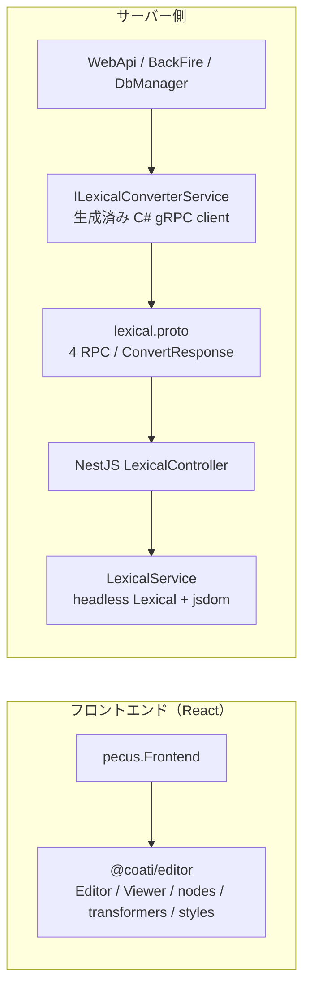

# エディタと Lexical 変換パイプライン

## 概要

Coati では Lexical を使う処理が、React 上で編集・表示する `@coati/editor` と、Node.js のヘッドレス変換サービス `pecus.LexicalConverter` に分かれています。前者は編集 UI、ビューア、カスタムノード、Markdown トランスフォーマー、CSS をパッケージとして公開し、後者は Lexical EditorState JSON から HTML／Markdown／プレーンテキストへの変換と、Markdown から EditorState JSON への変換を gRPC で提供します。[パッケージの公開定義](../../packages/coati-editor/package.json) [エディタの公開 API](../../packages/coati-editor/src/index.ts) [gRPC 契約](../../pecus.Protos/lexical/lexical.proto)

C# 側は `.proto` から生成されたクライアントを `ILexicalConverterService` の実装で包み、WebApi、BackFire、DbManager に登録します。ブラウザーの React UI と gRPC 変換サービスは別の実行経路です。共有されるのは Lexical のデータ形式やノード／トランスフォーマーであり、React UI が gRPC サービスを直接呼び出す構成ではありません。[C# クライアントラッパー](../../pecus.Libs/Lexical/LexicalConverterService.cs) [WebApi 登録](../../pecus.WebApi/Program.cs) [BackFire 登録](../../pecus.BackFire/Program.cs) [DbManager 登録](../../pecus.DbManager/Program.cs)

## React パッケージと利用側

`@coati/editor` は `package.json` の `exports` で、既定エントリ `.`、`./nodes`、`./nodes-headless`、`./transformers`、`./styles` を公開します。既定エントリは `src/index.ts` を通じて、Editor／Viewer 系コンポーネント、コンテキスト、UI 部品、プラグイン、ノード、テーマ、型、ユーティリティを再エクスポートします。`./nodes` と `./nodes-headless` はそれぞれ通常ノード定義とヘッドレス用ノード定義、`./transformers` は Markdown 変換器、`./styles` はビルド成果物の CSS へのエントリです。[exports と依存関係](../../packages/coati-editor/package.json) [既定エントリ](../../packages/coati-editor/src/index.ts) [通常ノード](../../packages/coati-editor/src/nodes/index.ts) [ヘッドレスノード](../../packages/coati-editor/src/nodes/headless.ts) [transformers エントリ](../../packages/coati-editor/src/transformers/index.ts) [CSS](../../packages/coati-editor/src/core/Editor.css)

React UI の中核は `Editor`、`NotionLikeEditor`、`Viewer`、`NotionLikeViewer` です。NotionLike 系のコンポーネントは `NotionLikeEditorNodes` を登録し、エディタでは入力・変更コールバックや Markdown の入出力を、ビューアでは読み取り専用の初期 EditorState 表示を担います。ビューアにも検索ハイライト等の表示用プラグインが含まれます。[コアのエクスポート](../../packages/coati-editor/src/core/index.ts) [NotionLikeEditor](../../packages/coati-editor/src/core/NotionLikeEditor.tsx) [NotionLikeViewer](../../packages/coati-editor/src/core/NotionLikeViewer.tsx) [Viewer](../../packages/coati-editor/src/core/Viewer.tsx) [ノード登録一覧](../../packages/coati-editor/src/nodes/NotionLikeEditorNodes.ts)

カスタムノードには、画像、数式、絵文字、折りたたみ、レイアウト、Mermaid、付箋、YouTube、Tweet、Figma、ページ区切り、日時などが含まれます。通常の `nodes` エントリはノードに加えて一部の React コンポーネントも公開します。`nodes-headless` はノード定義と作成・判定関数を公開し、React コンポーネントを含めずサーバー側から利用できる形に分けています。[通常ノードのエクスポート](../../packages/coati-editor/src/nodes/index.ts) [ヘッドレスノードのエクスポート](../../packages/coati-editor/src/nodes/headless.ts)

フロントエンドは `@coati/editor` をワークスペース依存として宣言し、React／Next.js 側で利用します。パッケージは React と React DOM を peer dependency として要求します。[Frontend の依存関係](../../pecus.Frontend/package.json) [editor の peer dependencies](../../packages/coati-editor/package.json)

## ヘッドレス変換サービス

NestJS の `LexicalService` は `createHeadlessEditor` で変換用のエディタを作り、標準ノードに加えて `@coati/editor/nodes-headless` から取り込んだカスタムノード群を登録します。Node.js で DOM API を使えるよう、モジュール初期化時に `jsdom` から `window`、`document`、`HTMLElement` などをグローバルへ設定します。初期化関数はプロセス内で一度だけ実行されます。[サービスと変換処理](../../pecus.LexicalConverter/src/lexical/lexical.service.ts) [DOM 環境](../../pecus.LexicalConverter/src/lexical/dom-environment.ts) [カスタムノードの参照元](../../pecus.LexicalConverter/src/lexical/nodes/index.ts)

Lexical JSON からの変換では、まず入力 JSON を走査して登録外の `type` を集め、その後 EditorState を読み込みます。HTML は `$generateHtmlFromNodes`、Markdown は `PLAYGROUND_TRANSFORMERS` による `$convertToMarkdownString`、プレーンテキストはルートノードの `getTextContent()` で生成します。未知ノードの一覧は変換結果に添えて返されます。コード上では、その一覧を返すことと、EditorState の解析・変換が成功するかどうかは別の処理です。[JSON 解析と各形式への変換](../../pecus.LexicalConverter/src/lexical/lexical.service.ts)

Markdown から JSON への変換では、リスト行のインデントを正規化してから同じヘッドレスエディタとトランスフォーマー群で EditorState を作り、JSON 化します。正規化処理は改行コードを LF に統一し、コードブロック外の対象リスト行についてインデントを調整します。エディタパッケージ側と NestJS 側には同じ関数の実装があり、双方のソースコメントも修正時の同期を明記しています。[NestJS 側の変換と正規化](../../pecus.LexicalConverter/src/lexical/lexical.service.ts) [NestJS 側 transformers](../../pecus.LexicalConverter/src/lexical/transformers/markdown-transformers.ts) [エディタ側 transformers](../../packages/coati-editor/src/transformers/markdown-transformers.ts)

## gRPC 契約と C# 呼び出し

gRPC の `LexicalConverter` サービスは `ToHtml`、`ToMarkdown`、`ToPlainText`、`FromMarkdown` の 4 RPC を定義します。前半の3つは `lexical_json`、`FromMarkdown` は `markdown` を受け取ります。共通のレスポンスには成功フラグ、結果文字列、任意のエラーメッセージ、処理時間（ミリ秒）、未知ノード一覧が含まれます。[Protocol Buffers 定義](../../pecus.Protos/lexical/lexical.proto)

NestJS のコントローラーは RPC ごとに `LexicalService` を呼び、成功時には結果と未知ノード一覧、例外時には `success: false` とエラーメッセージを返します。[gRPC コントローラー](../../pecus.LexicalConverter/src/lexical/lexical.controller.ts) C# の `Pecus.Libs.Lexical.LexicalConverterService` は生成済み `LexicalConverterClient` を使って RPC を呼び出し、レスポンスを `LexicalConvertResult` に写します。空の Lexical JSON は空結果を、空の Markdown は空の EditorState JSON をローカルで返すため、これらの入力では gRPC 呼び出しを行いません。[生成済み C# gRPC クライアント](../../pecus.Libs/Lexical/Generated/LexicalGrpc.cs) [C# インターフェースと結果型](../../pecus.Libs/Lexical/ILexicalConverterService.cs) [C# 呼び出し実装](../../pecus.Libs/Lexical/LexicalConverterService.cs)

WebApi、BackFire、DbManager はいずれも `ILexicalConverterService` を singleton として登録し、`LexicalConverter:Endpoint` と `LexicalConverter:GrpcApiKey` の設定から接続先と認証メタデータを渡します。サービス実装は `x-api-key` を gRPC metadata に付けます。ここではキーの値は扱いません。[WebApi 登録](../../pecus.WebApi/Program.cs) [BackFire 登録](../../pecus.BackFire/Program.cs) [DbManager 登録](../../pecus.DbManager/Program.cs) [認証 metadata の設定](../../pecus.Libs/Lexical/LexicalConverterService.cs)

NestJS の `GrpcApiKeyGuard` は RPC metadata の `x-api-key` を設定済みキーと比較します。ただし、サービス側で認証キーが未設定の場合は検証を通す分岐があり、キー未設定時に認証が必須になる動作ではありません。設定済みの場合、キーが欠落または一致しなければ `UNAUTHENTICATED` を返します。[gRPC 認証ガード](../../pecus.LexicalConverter/src/lexical/guards/grpc-api-key.guard.ts)

## 起動とレディネス

LexicalConverter は gRPC が listen を開始した後に、メトリクスおよびヘルスチェック用の HTTP サーバーを起動します。HTTP の `/health` は `status: ok` を返し、AppHost はこのエンドポイントをヘルスチェックとして設定してから DbManager を LexicalConverter に依存させます。したがって、このヘルスチェックは単に Node.js プロセスが立ち上がったかではなく、起動コード上では gRPC listen 開始後に応答するよう配置されています。[NestJS 起動処理](../../pecus.LexicalConverter/src/main.ts) [health エンドポイント](../../pecus.LexicalConverter/src/metrics/metrics.controller.ts) [AppHost のヘルスチェックと依存関係](../../pecus.AppHost/AppHost.cs)

## React UI と gRPC の境界

ブラウザー側は React コンポーネントを通じて編集・表示します。サーバー側は .NET 呼び出し元から gRPC 契約を介して NestJS の変換処理へ進みます。両者の接続点は gRPC ではなく、Lexical JSON などのデータ形式と共有するノード／変換定義です。[フロントエンド依存関係](../../pecus.Frontend/package.json) [gRPC 契約](../../pecus.Protos/lexical/lexical.proto) [ヘッドレス変換](../../pecus.LexicalConverter/src/lexical/lexical.service.ts)

## バージョンと共有実装の協調

ルートの `overrides`、エディタ、フロントエンド、NestJS 変換サービスの各 package 定義には Lexical 関連パッケージのバージョン指定があります。`scripts/update-lexical-version.js` はルートと3つの package 定義を対象に、`lexical` および `@lexical/*` の依存指定を更新します。オプション指定時には npm install やエディタのビルドも起動するスクリプトですが、このページの確認では実行していません。[ルート overrides](../../package.json) [editor の依存関係](../../packages/coati-editor/package.json) [Frontend の依存関係](../../pecus.Frontend/package.json) [Converter の依存関係](../../pecus.LexicalConverter/package.json) [更新スクリプト](../../scripts/update-lexical-version.js)

また、Markdown リストのインデント正規化は editor と NestJS に同一実装が置かれています。変更時は双方の実装を確認する必要があります。これはコード上に記載された同期上の注意であり、これ以外の未記載の設計意図はここでは仮定しません。[editor 側の正規化](../../packages/coati-editor/src/transformers/markdown-transformers.ts) [Converter 側の正規化](../../pecus.LexicalConverter/src/lexical/transformers/markdown-transformers.ts)

## 主なコード実体

| 役割 | 主なファイル |
| --- | --- |
| パッケージ公開面と依存関係 | [`packages/coati-editor/package.json`](../../packages/coati-editor/package.json)、[`src/index.ts`](../../packages/coati-editor/src/index.ts) |
| React エディタ／ビューア | [`src/core/NotionLikeEditor.tsx`](../../packages/coati-editor/src/core/NotionLikeEditor.tsx)、[`src/core/NotionLikeViewer.tsx`](../../packages/coati-editor/src/core/NotionLikeViewer.tsx)、[`src/core/Editor.css`](../../packages/coati-editor/src/core/Editor.css) |
| ノードと Markdown transformers | [`src/nodes/NotionLikeEditorNodes.ts`](../../packages/coati-editor/src/nodes/NotionLikeEditorNodes.ts)、[`src/nodes/headless.ts`](../../packages/coati-editor/src/nodes/headless.ts)、[`src/transformers/markdown-transformers.ts`](../../packages/coati-editor/src/transformers/markdown-transformers.ts) |
| NestJS 変換処理と RPC | [`src/lexical/lexical.service.ts`](../../pecus.LexicalConverter/src/lexical/lexical.service.ts)、[`src/lexical/lexical.controller.ts`](../../pecus.LexicalConverter/src/lexical/lexical.controller.ts)、[`lexical.proto`](../../pecus.Protos/lexical/lexical.proto) |
| .NET 契約・呼び出し | [`ILexicalConverterService.cs`](../../pecus.Libs/Lexical/ILexicalConverterService.cs)、[`LexicalConverterService.cs`](../../pecus.Libs/Lexical/LexicalConverterService.cs)、[`LexicalGrpc.cs`](../../pecus.Libs/Lexical/Generated/LexicalGrpc.cs) |

## 関連ページ

- [実行単位とサービス境界](./00-system-overview.md)
- [ユーザー・組織・ワークスペース・アイテム・タスク](./03-user-lifecycle-workspace-domain.md)
- [ローカル開発・設定・API／型生成](./09-local-development-code-generation.md)
- [本番ビルド・デプロイ・運用](./10-deployment-operations.md)

---

最終確認日: 2026-10-12
