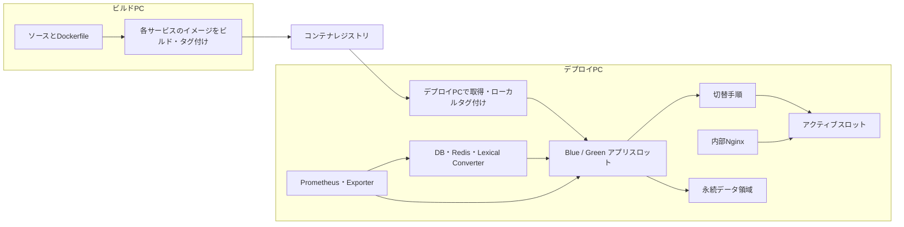

# デプロイと運用

## 概要

本番デプロイは、ビルドPCで全サービスを1つのimmutable releaseとして作成し、デプロイPCでmanifestと各イメージのdigest・Git revisionを検証してからBlue-Green切替する。データベースやRedis、Lexical Converter、内部Nginxはアプリケーションスロットとは別のCompose定義で管理する。[ビルド側スクリプト](../../deploy/build-pc/release.sh) [デプロイ側スクリプト](../../deploy/deploy-pc/deploy.sh) [運用CLI](../../deploy/ops/coati) [共通関数](../../deploy/lib/common.sh) [基盤Compose](../../deploy/docker-compose.infra.yml)

通常デプロイでは旧スロットのWeb APIとFrontendをNginx切替前後も保持し、障害時に戻せるようにする。DB migrationは新スロット起動前に実行するため、適用はExpand/Contractの後方互換設計を前提とする。BackFireだけは二重起動を避けるため、切替直前に旧側を停止して新側を起動する。[切替処理](../../deploy/ops/internal/deploy-release.sh)

## ビルドPCからデプロイPCまで

ビルド側はWeb API、Frontend、BackFire、DB Manager、Lexical Converterの全5サービスを同じGit revisionでビルドする。各イメージにはrelease IDとrevisionのOCIラベルを付け、immutable release tagへpushする。全イメージ成功後にmanifestへregistry digestを書き込み、最後に `latest` を更新する。`latest` はデプロイ対象にしない。[ビルド側スクリプト](../../deploy/build-pc/release.sh) [レジストリCompose](../../deploy/docker-compose.registry.yml)

デプロイ側はrelease IDを必須で受け取り、ビルドPCからmanifestを取得する。manifestのサービス構成、digest、OCIラベルのrelease IDとrevisionを検証し、非アクティブスロットのローカルタグへ反映する。[デプロイ側スクリプト](../../deploy/deploy-pc/deploy.sh)

設定値自体は記録しない。デプロイ側はビルドPCから本番設定の元ファイルをSSH経由で取得して実行用設定を生成する。[デプロイ側スクリプト](../../deploy/deploy-pc/deploy.sh)

図のビルド・転送境界は[ビルド側スクリプト](../../deploy/build-pc/release.sh)と[デプロイ側スクリプト](../../deploy/deploy-pc/deploy.sh)、デプロイPC内のサービス・ネットワーク構成は[基盤Compose](../../deploy/docker-compose.infra.yml)、[Blue Compose](../../deploy/docker-compose.app-blue.yml)、[Green Compose](../../deploy/docker-compose.app-green.yml)、[監視Compose](../../deploy/docker-compose.monitoring.yml)に基づく。

## Composeのサービス境界と切替順序

`docker-compose.infra.yml` はPostgreSQL、Redis（バックエンド用とFrontend用）、Lexical Converter、内部Nginxを定義する。アプリComposeはBlue用とGreen用に分かれ、それぞれWeb API、Frontend、BackFireを定義する。DB Managerは基盤Composeとマイグレーション用Composeを組み合わせた一時実行サービスで、起動順は運用スクリプトが制御する。[基盤Compose](../../deploy/docker-compose.infra.yml) [Blue Compose](../../deploy/docker-compose.app-blue.yml) [Green Compose](../../deploy/docker-compose.app-green.yml) [マイグレーションCompose](../../deploy/docker-compose.migrate.yml) [共通関数](../../deploy/lib/common.sh)

通常の切替処理は、概ね次の順で進む。

1. release manifest、イメージdigest、OCIラベルのrelease IDとGit revisionを検証する。
2. 基盤サービスを起動し、DB Managerのmigrationを先に実行する。
3. 対象スロットのWeb APIとFrontendを起動して内部スモークテストを行う。
4. 旧BackFireを停止して対象BackFireを起動する。
5. NginxとPrometheusターゲットを対象スロットへ切り替える。
6. 旧Web API/Frontendを停止せず、ロールバック用に保持する。[切替処理](../../deploy/ops/internal/deploy-release.sh) [ターゲット更新](../../deploy/ops/internal/update-prometheus-targets.sh) [スモークテスト](../../deploy/ops/internal/smoke-test-slot.sh)

BackFireは各スロットに定義されるが二重起動しない。切替処理が失敗した場合は、開始済みの新BackFireを停止して旧BackFireを復帰させ、Nginxを元のスロットへ戻す。[切替処理](../../deploy/ops/internal/deploy-release.sh)

### Nginxの経路と切替境界

内部Nginxは実行時生成されるアクティブスロット設定を読み、FrontendとWeb APIの上流先をBlueまたはGreenに対応付ける。`/backend/` はWeb APIへ転送する際にプレフィックスを除去し、`/backend/hubs/` はSignalR Hub用パスに変換してWebSocketのUpgradeを中継する。`/api/` とルート `/` はFrontendへ転送する。`/api/metrics` は内部監視向けの経路として別途アクセス制限が設定されている。[内部Nginx設定](../../deploy/nginx/conf.d/10-coati.conf)

切替処理はアクティブスロット設定を更新した後、Nginx設定を検査してreloadする。別ホスト側のNginxからこの内部Nginxへ中継する設定例も存在するが、それはBlue-Green切替そのものとは別の境界である。[共通関数](../../deploy/lib/common.sh) [任意の外部プロキシ設定](../../deploy/proxy-nginx/coati-bluegreen-proxy.conf)

## 永続データ、バックアップ、復元

ComposeではPostgreSQLとRedisのデータ、アプリケーションのアップロードファイル、BackFireの通知ファイル、各サービスのログをホスト側の永続領域に分けてマウントする。DB Managerもアップロード領域をマウントする。これらはコンテナイメージのBlue/Greenスロットとは別に保持されるデータであり、スロットの切替やイメージスナップショットだけで一括保存されるものではない。[基盤Compose](../../deploy/docker-compose.infra.yml) [Blue Compose](../../deploy/docker-compose.app-blue.yml) [Green Compose](../../deploy/docker-compose.app-green.yml) [マイグレーションCompose](../../deploy/docker-compose.migrate.yml)

PostgreSQLのバックアップComposeは `pg_dump` のカスタム形式ダンプをバックアップ領域に保存し、保持日数を過ぎた同種のダンプを削除する。復元は `ops/coati backup` / `restore` から実行し、アプリケーションを停止してからDBを削除・再作成する。[バックアップCompose](../../deploy/docker-compose.backup.yml) [復元Compose](../../deploy/docker-compose.restore-helper.yml) [運用CLI](../../deploy/ops/coati)

バックアップ／復元経路の対象はPostgreSQLだけである。アップロード領域や通知ファイルは別マウントであり、DBダンプのバックアップ対象に含まれない。[バックアップCompose](../../deploy/docker-compose.backup.yml) [復元Compose](../../deploy/docker-compose.restore-helper.yml)

**破壊的操作に注意:** `deploy.sh --initialize-db` はDBを削除・再作成し、`restore` も既存DBを置換する。両方とも通常デプロイとは分離し、明示確認を要求する。通常リリースはコンテナや未使用イメージをpruneしない。[デプロイ側スクリプト](../../deploy/deploy-pc/deploy.sh) [復元Compose](../../deploy/docker-compose.restore-helper.yml) [運用CLI](../../deploy/ops/coati)

## 本番監視と開発用設定

本番用監視ComposeはPrometheus、Node Exporter、Blackbox Exporterを定義し、Prometheusのデータ領域も永続化する。スロット切替後にターゲット更新処理がWeb API・Frontend・BackFireのファイルを更新する。[監視Compose](../../deploy/docker-compose.monitoring.yml) [本番Prometheus設定](../../deploy/ops/prometheus/prometheus.yml) [ターゲット更新](../../deploy/ops/internal/update-prometheus-targets.sh)

.NETの共通ServiceDefaultsはOpenTelemetryのASP.NET Core、HTTPクライアント、ランタイム計測とPrometheus exporterを登録し、`/metrics`、`/health`、`/alive` を公開する。FrontendにはPrometheusメトリクスを返す `/api/metrics` routeがあり、Lexical ConverterはgRPCサーバーとは別にHTTPメトリクスサーバーを立ち上げ、`/metrics` を提供する。本番Prometheus設定のスクレイプ先はそれぞれWeb APIの `/metrics`、Frontendの `/api/metrics`、Lexical Converterの `/metrics` である。[ServiceDefaults](../../pecus.ServiceDefaults/Extensions.cs) [Frontendメトリクスroute](../../pecus.Frontend/src/app/api/metrics/route.ts) [Lexical Converter起動処理](../../pecus.LexicalConverter/src/main.ts) [Lexical Converterメトリクス](../../pecus.LexicalConverter/src/metrics/metrics.controller.ts) [本番Prometheus設定](../../deploy/ops/prometheus/prometheus.yml)

本番ターゲットファイルとは別に、開発環境向けPrometheus設定とターゲットディレクトリがある。開発用設定ではバックエンドをHTTPSとして扱い、自己署名証明書の検証を無効にする設定が含まれる。これは本番用Prometheus Composeと同一の稼働形態を示すものではなく、開発用の設定上の区別である。[開発用Prometheus設定](../../deploy/ops/prometheus/prometheus.dev.yml) [開発用ターゲット群](../../deploy/ops/prometheus/targets-dev/) [本番Prometheus設定](../../deploy/ops/prometheus/prometheus.yml)

スモークテストはNginxコンテナ内から対象スロットのWeb API `/health` とFrontendルートを確認し、切替前に実行する。手動でも `ops/coati smoke` から実行できる。[スモークテスト](../../deploy/ops/internal/smoke-test-slot.sh) [運用CLI](../../deploy/ops/coati)

## 主なコード実体

| 役割 | 主な実体 |
|---|---|
| イメージ作成・レジストリ公開 | [release.sh](../../deploy/build-pc/release.sh)、[レジストリCompose](../../deploy/docker-compose.registry.yml) |
| イメージ取得・デプロイ | [deploy.sh](../../deploy/deploy-pc/deploy.sh) |
| Blue/GreenのCompose定義 | [infra](../../deploy/docker-compose.infra.yml)、[Blue](../../deploy/docker-compose.app-blue.yml)、[Green](../../deploy/docker-compose.app-green.yml)、[migration](../../deploy/docker-compose.migrate.yml) |
| 切替・共通処理 | [運用CLI](../../deploy/ops/coati)、[切替処理](../../deploy/ops/internal/deploy-release.sh)、[共通関数](../../deploy/lib/common.sh)、[Nginx設定](../../deploy/nginx/conf.d/10-coati.conf) |
| DBバックアップ・復元 | [backup Compose](../../deploy/docker-compose.backup.yml)、[restore Compose](../../deploy/docker-compose.restore-helper.yml)、[運用CLI](../../deploy/ops/coati) |
| 監視・疎通確認 | [monitoring Compose](../../deploy/docker-compose.monitoring.yml)、[Prometheus設定](../../deploy/ops/prometheus/prometheus.yml)、[ターゲット更新](../../deploy/ops/internal/update-prometheus-targets.sh)、[smoke test](../../deploy/ops/internal/smoke-test-slot.sh) |

## 関連資料と確認範囲

デプロイ経路や監視の詳細は、上記のスクリプト・Compose定義と各サービスの実装を参照する。本ページではリポジトリ内の現行シェル、Compose、Nginx、監視設定を確認したが、CIワークフローの実行実績や、リポジトリ外のCI・運用環境との接続は確認していない。したがって、ここで記した処理を外部CIが実行する、あるいは追加の運用手順が存在しないとは断定しない。

最終確認日: 2026-11-23
