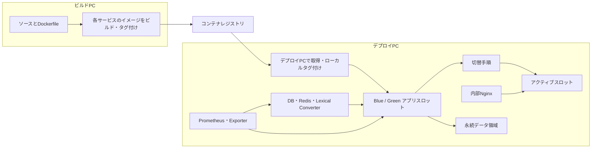

# デプロイと運用

## 概要

本番デプロイ用のシェルスクリプトは、ビルドPCでのコンテナイメージ作成・レジストリへの公開と、デプロイPCでのイメージ取得・Blue-Green切替を分担する。デプロイPCでは、データベースやRedis、Lexical Converter、内部Nginxなどの基盤サービスをアプリケーションスロットとは別のCompose定義で管理する。アプリ側はBlueとGreenに同じ種類のサービスを定義し、切替スクリプトが起動・停止・DBマイグレーション・Nginxの向き先変更を順に調整する。[ビルド側スクリプト](../../deploy/build-pc/build-and-push.sh) [デプロイ側スクリプト](../../deploy/deploy-pc/pull-and-deploy.sh) [切替スクリプト](../../deploy/ops/switch-node.sh) [運用共通関数](../../deploy/ops/lib.sh) [基盤Compose](../../deploy/docker-compose.infra.yml)

この構成はBlue-Greenの切替手順を実装しているが、ゼロダウンタイムを保証するものではない。特に旧スロット停止後にDBマイグレーションを実行し、その後に新スロットのBackFireとNginxを切り替えるため、処理の停止時間や各段階の失敗を含めて運用上の確認が必要となる。[切替スクリプト](../../deploy/ops/switch-node.sh)

## ビルドPCからデプロイPCまで

ビルド側スクリプトは、Web API、Frontend、BackFire、DB Manager、Lexical Converterに対応するDockerfileを選び、イメージをビルドする。タグには実行時刻に基づくバージョンと `latest` を付け、どちらもレジストリにプッシュする。Frontendについてはビルド引数も設定する。ここでの処理はデプロイPCでの起動とは独立しており、デプロイ側スクリプトはレジストリから指定バージョンを取得してローカルのBlue/Green用イメージ名にタグ付けした後、スロット切替を呼び出す。[ビルド側スクリプト](../../deploy/build-pc/build-and-push.sh) [レジストリCompose](../../deploy/docker-compose.registry.yml) [デプロイ側スクリプト](../../deploy/deploy-pc/pull-and-deploy.sh)

デプロイ側スクリプトは現在のアクティブスロットを読み取り、反対側をデプロイ対象にする。アクティブスロットを判定できない場合はBlueを選ぶ処理になっている。イメージを引き渡した後の起動順やトラフィック切替は、共通の `switch-node.sh` に委譲される。[運用共通関数](../../deploy/ops/lib.sh) [デプロイ側スクリプト](../../deploy/deploy-pc/pull-and-deploy.sh)

なお、デプロイ側スクリプトはイメージの取得とは別に、ビルドPCからデプロイ設定の元ファイルをSSH経由で受け取り、実行用の設定を生成する経路も持つ。ここでは設定値や接続先を記載しない。[デプロイ側スクリプト](../../deploy/deploy-pc/pull-and-deploy.sh)

図のビルド・転送境界は[ビルド側スクリプト](../../deploy/build-pc/build-and-push.sh)と[デプロイ側スクリプト](../../deploy/deploy-pc/pull-and-deploy.sh)、デプロイPC内のサービス・ネットワーク構成は[基盤Compose](../../deploy/docker-compose.infra.yml)、[Blue Compose](../../deploy/docker-compose.app-blue.yml)、[Green Compose](../../deploy/docker-compose.app-green.yml)、[監視Compose](../../deploy/docker-compose.monitoring.yml)に基づく。

## Composeのサービス境界と切替順序

`docker-compose.infra.yml` はPostgreSQL、Redis（バックエンド用とFrontend用）、Lexical Converter、内部Nginxを定義する。アプリComposeはBlue用とGreen用に分かれ、それぞれWeb API、Frontend、BackFireを定義する。各アプリスロットは同じ外部ネットワークに接続し、DB Managerは基盤Composeとマイグレーション用Composeを組み合わせた一時実行サービスとなる。アプリComposeの依存起動はComposeの `depends_on` では行わず、順序は運用スクリプト側が制御する。[基盤Compose](../../deploy/docker-compose.infra.yml) [Blue Compose](../../deploy/docker-compose.app-blue.yml) [Green Compose](../../deploy/docker-compose.app-green.yml) [マイグレーションCompose](../../deploy/docker-compose.migrate.yml) [運用共通関数](../../deploy/ops/lib.sh)

通常の切替処理は、概ね次の順で進む。

1. 基盤サービスの状態を確認し、対象スロットがすでに稼働中なら処理を止める。通常モードではリポジトリ更新と対象イメージのビルドも行う。
2. 対象スロットのWeb APIとFrontendを起動する。Web APIはコンテナのhealthcheckを待ち、FrontendはコンテナがRunningになるのを待つ。
3. DB Managerのマイグレーションイメージを準備し、稼働中なら旧スロットのWeb API・Frontend・BackFireを停止・削除する。
4. DBマイグレーションを実行する。
5. 対象スロットのBackFireを起動し、Runningになるのを待つ。
6. アクティブスロット設定を書き換え、Nginx設定を検査してからNginxをreloadする。
7. 停止済みコンテナや未使用イメージを整理し、Prometheusのスロット別ターゲットファイルを更新する。[切替スクリプト](../../deploy/ops/switch-node.sh) [運用共通関数](../../deploy/ops/lib.sh) [ターゲット更新スクリプト](../../deploy/ops/update-prometheus-targets.sh)

BackFireは各スロットに定義される一方、Composeのコメントと切替手順は二重起動しない前提で組み立てられている。旧スロットのBackFireを止めた後に対象側を起動するため、切替の途中では旧スロット停止済み・新スロット起動前という状態があり得る。切替の最後には停止済みイメージ等の整理もある。したがって、スロット切替をゼロダウンタイムや即時ロールバック可能性の保証として解釈してはならない。[Blue Compose](../../deploy/docker-compose.app-blue.yml) [Green Compose](../../deploy/docker-compose.app-green.yml) [切替スクリプト](../../deploy/ops/switch-node.sh)

### Nginxの経路と切替境界

内部Nginxは生成されたアクティブスロット設定を読み、FrontendとWeb APIの上流先をBlueまたはGreenに対応付ける。`/backend/` はWeb APIへ転送する際にプレフィックスを除去し、`/backend/hubs/` はSignalR Hub用パスに変換してWebSocketのUpgradeを中継する。`/api/` とルート `/` はFrontendへ転送する。`/api/metrics` は内部監視向けの経路として別途アクセス制限が設定されている。[内部Nginx設定](../../deploy/nginx/conf.d/10-coati.conf) [アクティブスロット設定](../../deploy/nginx/conf.d/00-active-slot.conf)

切替スクリプトはアクティブスロット設定を更新した後、Nginx設定の検査に成功した場合にreloadを依頼する。別ホスト側のNginxからこの内部Nginxへ中継する設定例も存在するが、それは任意の外部プロキシ層であり、Blue-Green切替そのものとは別の境界である。[切替スクリプト](../../deploy/ops/switch-node.sh) [任意の外部プロキシ設定](../../deploy/proxy-nginx/coati-bluegreen-proxy.conf)

## 永続データ、バックアップ、復元

ComposeではPostgreSQLとRedisのデータ、アプリケーションのアップロードファイル、BackFireの通知ファイル、各サービスのログをホスト側の永続領域に分けてマウントする。DB Managerもアップロード領域をマウントする。これらはコンテナイメージのBlue/Greenスロットとは別に保持されるデータであり、スロットの切替やイメージスナップショットだけで一括保存されるものではない。[基盤Compose](../../deploy/docker-compose.infra.yml) [Blue Compose](../../deploy/docker-compose.app-blue.yml) [Green Compose](../../deploy/docker-compose.app-green.yml) [マイグレーションCompose](../../deploy/docker-compose.migrate.yml)

PostgreSQLのバックアップComposeは `pg_dump` のカスタム形式ダンプをバックアップ領域に保存し、保持日数を過ぎた同種のダンプを削除する。復元Composeはダンプを検証した後、対象DBへの接続を終了し、そのデータベースを削除・再作成してから `pg_restore` する。復元スクリプトはアプリケーションを停止してからこの処理を行い、復元後もアプリのコンテナは停止状態のままとする。[バックアップCompose](../../deploy/docker-compose.backup.yml) [バックアップスクリプト](../../deploy/ops/pg-backup.sh) [復元Compose](../../deploy/docker-compose.restore-helper.yml) [復元スクリプト](../../deploy/ops/pg-restore.sh)

このバックアップ／復元経路が対象にするのはPostgreSQLデータベースである。アップロード領域や通知ファイルは別のマウント先であり、確認したバックアップ／復元スクリプトにそれらのアーカイブや復元処理はない。したがって、DBダンプをそれらのファイルのバックアップとみなすことはできない。イメージスナップショットのスクリプトも対象はコンテナイメージである。[バックアップCompose](../../deploy/docker-compose.backup.yml) [復元Compose](../../deploy/docker-compose.restore-helper.yml) [イメージスナップショット作成](../../deploy/ops/snapshot-create.sh) [イメージスナップショット復元](../../deploy/ops/snapshot-restore.sh) [Blue Compose](../../deploy/docker-compose.app-blue.yml) [Green Compose](../../deploy/docker-compose.app-green.yml)

**破壊的操作に注意:** DBリセット付き切替やDBリセットスクリプトは、DBの初期化に加えてアップロード領域のファイルを削除する処理を含む。DB復元は既存DBを削除・再作成する。さらにビルド側スクリプトの末尾には、ビルドPC上のDocker Engineに対して未使用イメージやボリュームを対象にpruneを行う処理がある。これらは通常デプロイと同等の非破壊操作ではなく、対象データ・実行環境への影響を確認せずに扱うべきではない。[切替スクリプト](../../deploy/ops/switch-node.sh) [DBリセット・マイグレーションスクリプト](../../deploy/ops/db-reset-migrate.sh) [復元Compose](../../deploy/docker-compose.restore-helper.yml) [ビルド側スクリプト](../../deploy/build-pc/build-and-push.sh)

## 本番監視と開発用設定

本番用監視ComposeはPrometheus、Node Exporter、Blackbox Exporterを定義し、Prometheusのデータ領域も永続化する。Prometheus設定はfile-based service discovery（`file_sd_configs`）を使い、Web API、Frontend、Lexical Converter、Node Exporter、Blackbox Exporterのターゲットをファイルから読み込む。スロット切替後に更新スクリプトがWeb API・Frontendのターゲットをアクティブスロットに合わせて書き換える。スクリプトはBackFire用ターゲットファイルも生成するが、確認した本番Prometheus設定にはBackFireをスクレイプするjobは定義されていない。[監視Compose](../../deploy/docker-compose.monitoring.yml) [本番Prometheus設定](../../deploy/ops/prometheus/prometheus.yml) [ターゲット更新スクリプト](../../deploy/ops/update-prometheus-targets.sh)

.NETの共通ServiceDefaultsはOpenTelemetryのASP.NET Core、HTTPクライアント、ランタイム計測とPrometheus exporterを登録し、`/metrics`、`/health`、`/alive` を公開する。FrontendにはPrometheusメトリクスを返す `/api/metrics` routeがあり、Lexical ConverterはgRPCサーバーとは別にHTTPメトリクスサーバーを立ち上げ、`/metrics` を提供する。本番Prometheus設定のスクレイプ先はそれぞれWeb APIの `/metrics`、Frontendの `/api/metrics`、Lexical Converterの `/metrics` である。[ServiceDefaults](../../pecus.ServiceDefaults/Extensions.cs) [Frontendメトリクスroute](../../pecus.Frontend/src/app/api/metrics/route.ts) [Lexical Converter起動処理](../../pecus.LexicalConverter/src/main.ts) [Lexical Converterメトリクス](../../pecus.LexicalConverter/src/metrics/metrics.controller.ts) [本番Prometheus設定](../../deploy/ops/prometheus/prometheus.yml)

本番ターゲットファイルとは別に、開発環境向けPrometheus設定とターゲットディレクトリがある。開発用設定ではバックエンドをHTTPSとして扱い、自己署名証明書の検証を無効にする設定が含まれる。これは本番用Prometheus Composeと同一の稼働形態を示すものではなく、開発用の設定上の区別である。[開発用Prometheus設定](../../deploy/ops/prometheus/prometheus.dev.yml) [開発用ターゲット群](../../deploy/ops/prometheus/targets-dev/) [本番Prometheus設定](../../deploy/ops/prometheus/prometheus.yml)

スモークテスト用スクリプトはNginxコンテナ内から各稼働スロットへ接続し、Web APIの `/health` が200であること、Frontendのルートが許可された成功・リダイレクト応答であることを確認する。これはデプロイ切替スクリプトの最後に自動実行される処理ではなく、独立した検証用スクリプトである。[スモークテストスクリプト](../../deploy/ops/smoke-test.sh) [切替スクリプト](../../deploy/ops/switch-node.sh)

## 主なコード実体

| 役割 | 主な実体 |
|---|---|
| イメージ作成・レジストリ公開 | [build-and-push.sh](../../deploy/build-pc/build-and-push.sh)、[レジストリCompose](../../deploy/docker-compose.registry.yml) |
| イメージ取得・デプロイ委譲 | [pull-and-deploy.sh](../../deploy/deploy-pc/pull-and-deploy.sh) |
| Blue/GreenのCompose定義 | [infra](../../deploy/docker-compose.infra.yml)、[Blue](../../deploy/docker-compose.app-blue.yml)、[Green](../../deploy/docker-compose.app-green.yml)、[migration](../../deploy/docker-compose.migrate.yml) |
| 切替・共通処理 | [switch-node.sh](../../deploy/ops/switch-node.sh)、[lib.sh](../../deploy/ops/lib.sh)、[Nginx設定](../../deploy/nginx/conf.d/10-coati.conf) |
| DBバックアップ・復元 | [backup Compose](../../deploy/docker-compose.backup.yml)、[restore Compose](../../deploy/docker-compose.restore-helper.yml)、[pg-backup.sh](../../deploy/ops/pg-backup.sh)、[pg-restore.sh](../../deploy/ops/pg-restore.sh) |
| 監視・疎通確認 | [monitoring Compose](../../deploy/docker-compose.monitoring.yml)、[Prometheus設定](../../deploy/ops/prometheus/prometheus.yml)、[ターゲット更新](../../deploy/ops/update-prometheus-targets.sh)、[smoke-test.sh](../../deploy/ops/smoke-test.sh) |

## 関連資料と確認範囲

デプロイ経路や監視の詳細は、上記のスクリプト・Compose定義と各サービスの実装を参照する。本ページではリポジトリ内の現行シェル、Compose、Nginx、監視設定を確認したが、CIワークフローの実行実績や、リポジトリ外のCI・運用環境との接続は確認していない。したがって、ここで記した処理を外部CIが実行する、あるいは追加の運用手順が存在しないとは断定しない。

最終確認日: 2026-10-12
