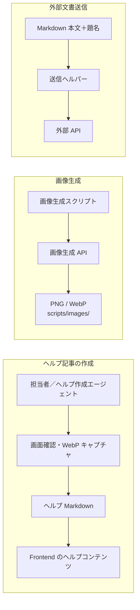

# エージェント・ヘルプ・成果物作成フロー

## 概要

このページでは、リポジトリに置かれたエージェント定義、スキル、補助スクリプトを、開発者または利用者が依頼・起動するコンテンツ作成フローとして説明する。これらの定義はアプリケーションの実行時機能ではなく、Coati のヘルプや開発者向け文書、画像などを準備するための作業支援である。[コードベース解説エージェント](../../.github/agents/codebase-docs-ja.agent.md) [ヘルプ作成エージェント](../../.github/agents/coati-help-author.agent.md) [ヘルプ作成スキル](../../.github/skills/coati-help-author/SKILL.md)

主な流れは、担当者がエージェントへ作業を依頼し、定義された手順で入力を調べて成果物を作成し、必要に応じて別のスクリプトが画像変換や外部 API との境界を担う、というものになる。ヘルプの読み込みと検索インデックス生成だけは Frontend のコードから実行されるが、記事の作成自体は開発作業である。[ヘルプ記事ローダー](../../pecus.Frontend/src/libs/help/getHelpContent.ts) [検索インデックス生成スクリプト](../../pecus.Frontend/scripts/generate-help-index.ts) [Frontend の npm scripts](../../pecus.Frontend/package.json)

## エージェント定義とスキルの役割

`.github/agents/` のエージェント定義は、担当する役割、利用可能なツール、依頼の入口、作業制約や完了時の報告を記述する。たとえばコードベース解説エージェントはユーザーから起動でき、各ページの執筆をページ執筆エージェントに割り当てる。一方、ページ執筆エージェントはユーザー起動ではなく、親から割り当てられた1ページだけを編集する設定である。[コードベース解説エージェント](../../.github/agents/codebase-docs-ja.agent.md) [ページ執筆エージェント](../../.github/agents/codebase-docs-page-ja.agent.md)

スキルは、特定作業に適用する手順、参照対象、安全境界をまとめる。`coati-help-author` はヘルプ記事と画像の準備手順、`coati-markdown-submit` は Markdown 文書を外部 API に渡すための処理仕様をそれぞれ定義する。エージェントの役割定義とスキルの手順定義はいずれも開発ワークフロー上の指示であり、アプリに登録される Bot やユーザー向け機能を意味しない。[ヘルプ作成スキル](../../.github/skills/coati-help-author/SKILL.md) [Markdown 送信スキル](../../.github/skills/coati-markdown-submit/SKILL.md) [Bot アイコン生成スクリプト](../../scripts/generate-bot-icons.js)

同じ境界は、Lexical の変換作業や汎用の補助作業にも当てはまる。`lexical-converter-grpc` は Lexical JSON から HTML／Markdown／PlainText へ変換し、Markdown から Lexical JSON へ戻す手順、gRPC の `x-api-key` メタデータ、`.NET` クライアントと NestJS サーバーの確認手順を定義する。これは変換サービス自体の実装・起動ではなく、開発時の利用・統合作業を説明するスキルである。[Lexical Converter gRPC スキル](../../.github/skills/lexical-converter-grpc/SKILL.md) UI 実装向けの `flyonui`、動作を変えない小刻みな整理を扱う `refactor`、localhost の共有ブラウザー確認を扱う `localhost-debug-browser`／`chrome-devtools` も、依頼時に参照する開発支援ルールである。これらを実行時サービス、定期処理、または自動的に常時適用される品質機構とは解釈しない。[FlyonUI スキル](../../.github/skills/flyonui/SKILL.md) [refactor スキル](../../.github/skills/refactor/SKILL.md) [localhost デバッグブラウザースキル](../../.github/skills/localhost-debug-browser/SKILL.md) [Chrome DevTools スキル](../../.github/skills/chrome-devtools/SKILL.md)

## 計画からページを書く流れ

コードベース解説では、親エージェントがページの役割と執筆範囲を組み立て、ページ執筆エージェントへ出力先1ファイルと作業を割り当てる。執筆側は割り当てられた論点について現行ソースを確認し、ページ本文と根拠リンクを作る。親エージェントは各ページの完了後に文書群を統合し、索引を整える役割として定義されている。[コードベース解説エージェント](../../.github/agents/codebase-docs-ja.agent.md) [ページ執筆エージェント](../../.github/agents/codebase-docs-page-ja.agent.md)

計画担当のエージェントはページ分割や各ページで扱う論点を計画する役割であり、ページ本文を代わりに作るものではない。解説ページの執筆エージェントは、割り当て範囲を越えて他ページや索引を編集しないよう定義されている。[計画担当エージェント](../../.github/agents/codebase-docs-outline-ja.agent.md) [ページ執筆エージェント](../../.github/agents/codebase-docs-page-ja.agent.md)

## ヘルプ記事と検索インデックス

ヘルプ作成エージェントはユーザー起動可能な作業担当として定義され、対象画面・機能の確認、ローカル画面のキャプチャ、記事 Markdown 作成を行う。ヘルプ作成スキルは記事を `pecus.Frontend/src/content/help/ja/`、画像を `pecus.Frontend/public/help/images/` に置く前提を示す。記事は実装と画面で確認できた内容を記し、スクリーンショットを含む場合は WebP を参照する。画面キャプチャを伴わない記事は、文章のみの依頼が明示された場合に限る手順になっている。[ヘルプ作成エージェント](../../.github/agents/coati-help-author.agent.md) [ヘルプ作成スキル](../../.github/skills/coati-help-author/SKILL.md)

JPEG/JPG 素材を WebP にする補助スクリプトは入力拡張子を検査し、出力を排他的に作成するため既存の出力を上書きしない。変換が成功すると元画像は既定で削除され、保持する場合は `--keep` を指定する設計である。[WebP 変換スクリプト](../../scripts/convert-to-webp.js) ヘルプ作成側は、生成インデックスを直接編集せず、Markdown 記事を入力として扱う。[ヘルプ作成スキル](../../.github/skills/coati-help-author/SKILL.md)

Frontend のローダーはロケール別のヘルプディレクトリから `.md` を読み、記事タイトルと数値接頭辞による順序を返す。検索インデックス生成スクリプトは日本語ヘルプ Markdown を読み、本文・見出し・順序などを JSON に出力する。`predev` と `prebuild` はこの生成処理を呼び出すため、開発起動前またはビルド前にインデックスを作る構成である。[ヘルプ記事ローダー](../../pecus.Frontend/src/libs/help/getHelpContent.ts) [検索インデックス生成スクリプト](../../pecus.Frontend/scripts/generate-help-index.ts) [Frontend の npm scripts](../../pecus.Frontend/package.json)

## Markdown を外部 API に渡す境界

Markdown 送信ヘルパーは、題名と Markdown 本文（本文を直接与えるか、ファイルから読むか）を入力として受け取り、ワークスペースと所有者の識別情報を送信メタデータに加える。スクリプトは JSON の `subject`、`body`、`ownerLoginId` を作り、外部 API のワークスペース項目コレクションに HTTP POST する。この処理はローカルの作成ワークフローから外部サービスへ出る境界であり、アプリ画面内で Markdown を投稿する実行時機能としては説明しない。[Markdown 送信スクリプト](../../.github/skills/coati-markdown-submit/scripts/submit-markdown.js) [Markdown 送信スキル](../../.github/skills/coati-markdown-submit/SKILL.md)

ただし、現行の Web API 側で確認できる `ExternalController` には、アイテム一覧・詳細やタスク情報を取得する GET アクションと疎通確認用アクションがある一方、送信スクリプトが使う項目コレクションへの POST 作成アクションは定義されていない。基底コントローラーは API キー認証を要求し、アクション属性によるロール確認を行う。したがって、このヘルパーの送信先とこのリポジトリ内の受信側実装が同一の経路であるとは確認できず、送信先の受け入れ先は外部 API の境界として扱う。[Markdown 送信スクリプト](../../.github/skills/coati-markdown-submit/scripts/submit-markdown.js) [外部 API コントローラー](../../pecus.WebApi/Controllers/External/ExternalController.cs) [外部 API 基底コントローラー](../../pecus.WebApi/Controllers/External/BaseExternalApiController.cs)

このページは送信入力と境界を説明するもので、認証情報の設定や実際に送信する手順は扱わない。スクリプトが認証情報を必要とすることは実装上確認できるが、値は掲載しない。[Markdown 送信スクリプト](../../.github/skills/coati-markdown-submit/scripts/submit-markdown.js)

## Bot アイコンと実績バッジ画像

2つの画像生成スクリプトは、コード内に定義した識別子・ファイル名・プロンプトを入力として画像生成 API を呼び出し、`scripts/images/` に PNG と WebP を出力する。`--code=<識別子>` で対象を絞り、`--dry-run` では生成 API を呼ばずにプロンプトを表示する。API 認証情報が必要な通常実行の具体的な設定方法はここでは扱わない。[Bot アイコン生成スクリプト](../../scripts/generate-bot-icons.js) [実績バッジ生成スクリプト](../../scripts/generate-achievement-badges.js)

通常実行では、Bot アイコン生成は対象 PNG が既にある場合にその項目をスキップし、実績バッジ生成も既存 PNG をスキップする。両スクリプトとも `--dry-run` で既存 PNG が見つかると WebP 変換を行うため、dry run は API 呼び出しをしない一方、既存画像がある場合は変換ファイルを書き出す処理を含む。Bot アイコン側は 512×512 にリサイズして WebP 化し、実績バッジ側は WebP 化する。出力先はヘルプ画像フォルダーではなく、各スクリプトに対応する `scripts/images/` である。[Bot アイコン生成スクリプト](../../scripts/generate-bot-icons.js) [実績バッジ生成スクリプト](../../scripts/generate-achievement-badges.js)

## 静的なスキルレビュー

「スキル検閲官」エージェントはユーザー起動可能な静的レビュー担当で、スキルや関連エージェント定義を読み、安全性、権限範囲、明確性、整合性、保守性を確認する。定義上、スキルを実行・改変せず、ターミナル、外部 API、ブラウザーなどによるランタイム検証も行わない。したがって、レビュー結果は記述内容の静的確認に限られ、実行時の挙動確認とは異なる。[スキル検閲エージェント](../../.github/agents/skill-censor-ja.agent.md)

## フローの分離

下図は、ヘルプ記事作成、画像生成、Markdown 外部送信を独立した開発作業として分けて示す。ヘルプ作成は記事とキャプチャを Frontend のコンテンツへ置き、画像生成スクリプトは `scripts/images/` に成果物を置く。Markdown 送信ヘルパーは本文・メタデータを外部 API に送る役割であり、ヘルプローダーや画像生成スクリプトの後段ではない。[ヘルプ作成スキル](../../.github/skills/coati-help-author/SKILL.md) [Bot アイコン生成スクリプト](../../scripts/generate-bot-icons.js) [実績バッジ生成スクリプト](../../scripts/generate-achievement-badges.js) [Markdown 送信スクリプト](../../.github/skills/coati-markdown-submit/scripts/submit-markdown.js)

## 主なコード実体

| 実体 | 役割 |
| --- | --- |
| [コードベース解説エージェント](../../.github/agents/codebase-docs-ja.agent.md)、[計画担当エージェント](../../.github/agents/codebase-docs-outline-ja.agent.md)、[ページ執筆エージェント](../../.github/agents/codebase-docs-page-ja.agent.md) | 解説の計画、ページ単位の執筆割り当て、本文作成の役割を分担する。 |
| [ヘルプ作成エージェント](../../.github/agents/coati-help-author.agent.md)、[ヘルプ作成スキル](../../.github/skills/coati-help-author/SKILL.md) | 画面確認、WebP キャプチャ、ヘルプ Markdown 作成の開発手順を定義する。 |
| [ヘルプ記事ローダー](../../pecus.Frontend/src/libs/help/getHelpContent.ts)、[検索インデックス生成スクリプト](../../pecus.Frontend/scripts/generate-help-index.ts) | 保存済みヘルプ Markdown を読み込み、検索用 JSON を生成する。 |
| [WebP 変換スクリプト](../../scripts/convert-to-webp.js) | JPEG/JPG 素材を WebP に変換する。 |
| [Bot アイコン生成スクリプト](../../scripts/generate-bot-icons.js)、[実績バッジ生成スクリプト](../../scripts/generate-achievement-badges.js) | 定義済みプロンプトを用いた画像生成・変換を行う。 |
| [Markdown 送信スキル](../../.github/skills/coati-markdown-submit/SKILL.md)、[Markdown 送信スクリプト](../../.github/skills/coati-markdown-submit/scripts/submit-markdown.js) | Markdown とメタデータを外部 API に渡す境界を定義・実装する。 |
| [スキル検閲エージェント](../../.github/agents/skill-censor-ja.agent.md) | スキル定義を実行せずに静的レビューする。 |

## 関連ページ

- [Web API・認証・公開契約](02-webapi-boundary-security.md) — 外部 API の受信側コントローラーと認証境界。
- [アジェンダ・Focus・実績](07-agenda-focus-achievements.md) — 実績機能の実行時側と、ここで扱ったバッジ画像作成作業の区別。
- [ローカル開発・設定・API／型生成](09-local-development-code-generation.md) — 開発時の生成処理との関連。

---

**最終確認日:** 2026-10-12
